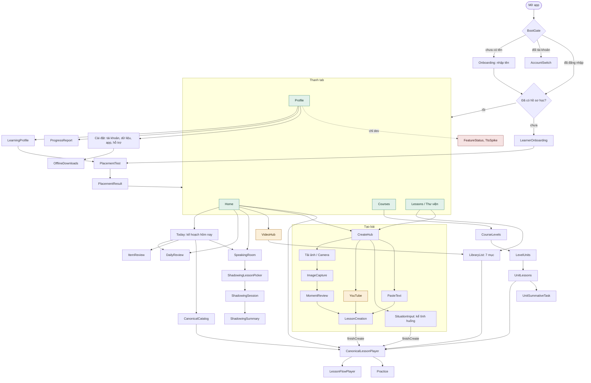

# Bản đồ tính năng đang hoạt động

> Dựng lại từ code, không từ tài liệu cũ. Snapshot: App `main @ a1826c8`,
> Server `main @ cdb698f`, cờ tính năng theo `src/core/release/configs/production.ts`
> (11/10/2026). Khi thêm/bỏ màn hình, route hoặc cờ, cập nhật lại file này.

Nguồn chính:

- Màn hình và luồng: `src/app/navigation/AppNavigator.tsx`, `rootStackRoutes.ts`,
  `appNavigationAdapter.ts` (xem thêm [`navigation.md`](./navigation.md)).
- Cờ tính năng: `src/core/release/feature-registry.ts`, `configs/production.ts`.
- API server: các `controller` trong `LingoBites-Server/src/modules/*` và `src/app/controller`.

## 1. Toàn cảnh điều hướng

Chú thích màu: xanh = tab chính, vàng = beta / cần server hỗ trợ, đỏ = chỉ bản dev.

## 2. Các nhóm tính năng đang chạy

### Tài khoản & khởi động

Tạo người dùng theo thiết bị, làm mới phiên, kiểm tra lại server khi app trở
lại foreground (chế độ offline).

- Màn hình: `BootGate`, `Onboarding`, `AccountSwitch`
- API: `POST /v1/users`, `POST /v1/auth/refresh`, `GET /v1/me`, `GET /v1/capabilities`

### Hồ sơ học & xếp lớp

Người học chưa có hồ sơ phải qua onboarding và bài kiểm tra xếp lớp trước khi
vào tab. Có thể làm lại từ Profile.

- Màn hình: `LearnerOnboarding`, `PlacementTest`, `PlacementResult`, `LearningProfile`
- API: `GET|PUT /v1/me/learner-profile`, `GET /v1/placement/test`, `POST /v1/placement/submit`

### Tạo bài từ nội dung riêng

4 nguồn trong `CreateHub`. Tất cả cần server; khi offline các ô vẫn hiện nhưng
bị khoá.

| Nguồn                   | Luồng                                                                         |
| ----------------------- | ----------------------------------------------------------------------------- |
| Ảnh (camera / thư viện) | `ImageCapture` → phân tích ảnh → `MomentReview` → xác nhận → `LessonCreation` |
| Dán văn bản             | `PasteText` → `LessonCreation`                                                |
| Kể tình huống           | `SituationInput` → tạo bài → mở bài                                           |
| YouTube (beta)          | nhập link → `LessonCreation`; ô chỉ hiện khi server báo hỗ trợ                |

- API: `POST /api/v1/images/analyze`, `POST /api/v1/lesson-creations`,
  `POST /api/v1/lesson-creations/:id/confirm`, `POST /api/v1/moments`,
  `GET /api/v1/situations`

### Học bài

Một trình phát bài dùng chung cho mọi nơi mở bài (Home, Thư viện, Giáo trình,
Today). Từ đó vào luồng hoạt động theo khối hoặc luyện ngắn.

- Màn hình: `CanonicalLessonPlayer`, `LessonFlowPlayer`, `Practice`, `CanonicalCatalog`
- API: `GET /api/v1/lessons`, `GET|DELETE /api/v1/lessons/:id`,
  `GET /api/v1/lessons/:id/source-image`, `POST /v1/evaluations/text`,
  `GET /v1/evaluations/:attemptId`

### Giáo trình có cấu trúc

Course → Level → Unit → Lesson, kèm bài tổng kết (summative task) cuối Unit.
Quyền truy cập khoá học theo entitlement.

- Màn hình: `CourseList`, `CourseLevels`, `LevelUnits`, `UnitLessons`, `UnitSummativeTask`
- API: `GET /v1/courses`, `GET /v1/courses/:slug/levels`, `GET /v1/levels/:id/units`,
  `GET /v1/units/:id/lessons`, `GET /v1/units/:id/summative-task`,
  `GET /v1/me/course-entitlements`

### Luyện tập & ôn tập

`Today` gom việc cần làm trong ngày. Ôn tập lặp lại ngắt quãng chạy trên dữ
liệu cục bộ, sự kiện ôn được gửi lên server. Phòng nói có luyện shadowing.

- Màn hình: `Today`, `DailyReview`, `ItemReview`, `SpeakingRoom`,
  `ShadowingLessonPicker`, `ShadowingSession`, `ShadowingSummary`
- API: `POST /v1/review-events`

### Thư viện (tab Lessons)

Hai nhóm. **Của tôi:** Bài học, Khoảnh khắc, Video, Từ vựng, Ngữ pháp.
**Khám phá:** Bài học công khai, Video công khai. `VideoHub` trên Home mở thẳng
vào mục video.

- Màn hình: `LessonsList`, `LibraryList`, `VideoHub`
- API: `GET /api/v1/moments/library`, `GET /api/v1/lessons`

### Hồ sơ, cài đặt & offline

Mục tiêu tuần, nhắc học, báo cáo tiến độ, cài đặt tài khoản / dữ liệu / giao
diện (7 theme màu), tải bài để học offline. Dữ liệu cục bộ đồng bộ đẩy lên server.

- Màn hình: `ProfileMain`, `ProgressReport`, `AccountSettings`, `DataSettings`,
  `OfflineDownloads`, `AppSettings`, `SupportAbout`, `PrivacyNote`
- API: `POST /v1/sync/push`, `PATCH /v1/me`

## 3. Chưa bật hoặc chỉ có một phần

| Mục                                           | Trạng thái              | Ghi chú                                                                                    |
| --------------------------------------------- | ----------------------- | ------------------------------------------------------------------------------------------ |
| Tạo bài từ YouTube                            | Beta                    | Cờ `youtubeLearning` bật, nhưng ô chỉ hiện khi server trả capability.                      |
| Hỗ trợ phát âm                                | Chưa làm                | Cờ `pronunciationSupport` có trong registry nhưng tắt ở production.                        |
| Cờ `situationLearning`                        | Chưa làm                | Cờ vẫn tắt, nhưng ô "Kể tình huống" trong `CreateHub` không phụ thuộc cờ này nên vẫn hiện. |
| `FeatureStatus`, `TtsSpike`                   | Chỉ dev                 | Chỉ đăng ký khi `__DEV__`.                                                                 |
| OCR riêng & pipeline phân tích AI bất đồng bộ | Đã gỡ                   | Gỡ khỏi server ở commit `d8e9942`. Luồng ảnh hiện đi qua `/api/v1/images/analyze`.         |
| Bản ghi âm trên server                        | Server có, app chưa gọi | Route `/v1/recordings` tồn tại nhưng không thấy app gọi trực tiếp.                         |

## 4. Phía quản trị (admin-web, repo Server)

Không thuộc app người học, nhưng là nơi sinh nội dung cho Giáo trình và Thư
viện công khai: quản lý Course/Level/Unit/Lesson, khối bài và hoạt động, item
từ vựng/mẫu câu, soạn bài bằng AI (compose) và hạn mức, quản lý prompt AI,
transcript YouTube, media, người dùng, chấm điểm và báo cáo lỗi item. Tất cả
nằm dưới `/v1/admin/*`.
