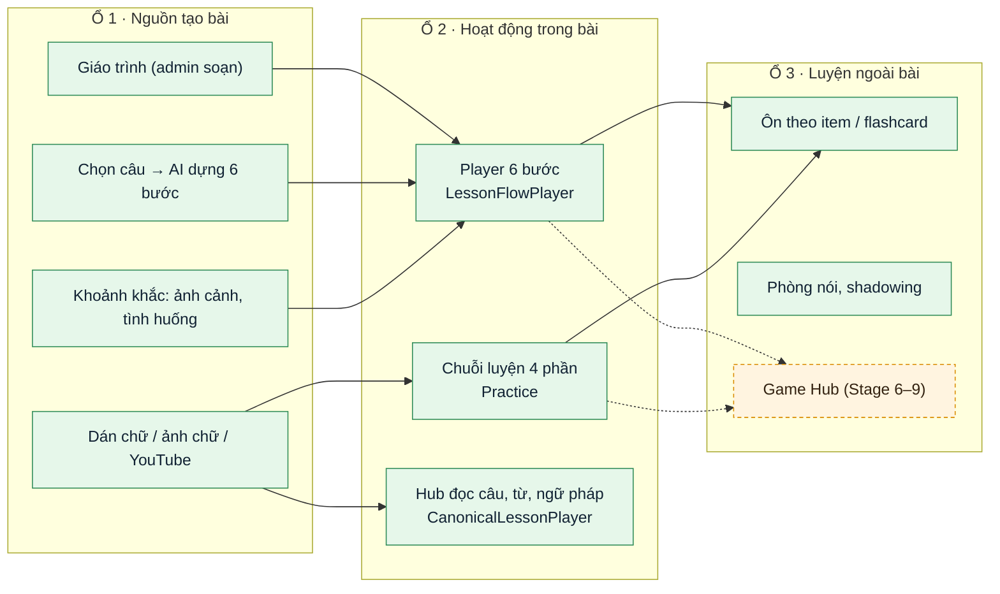
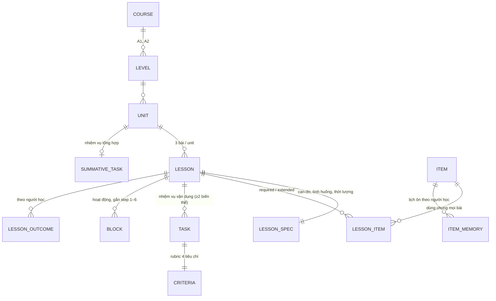
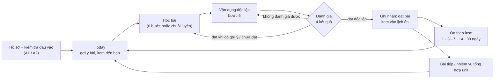
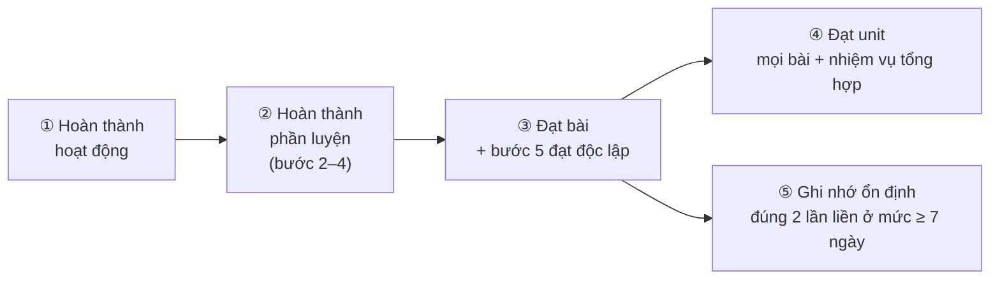
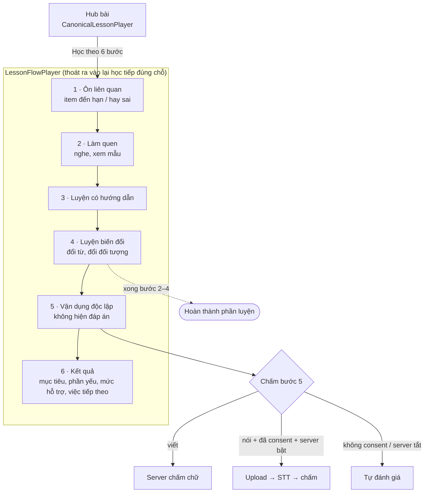
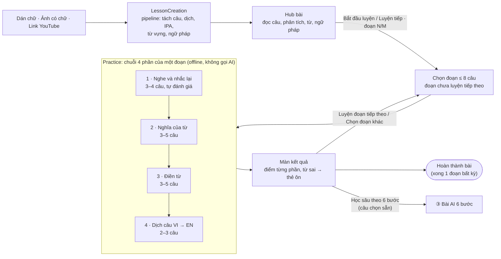
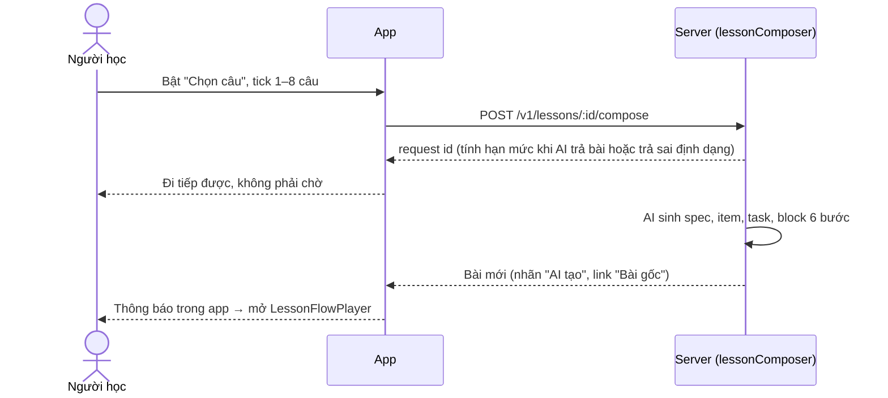
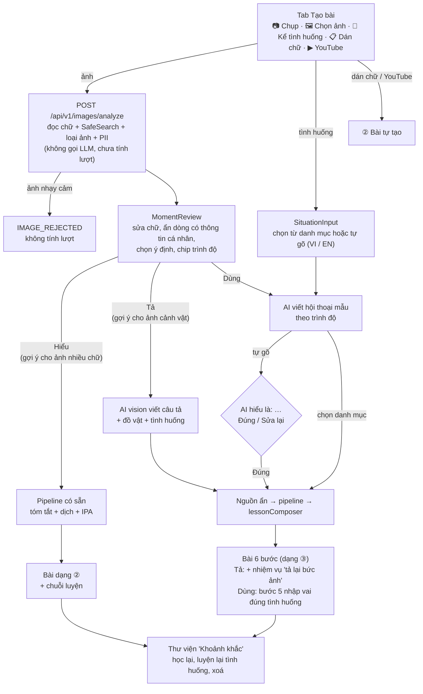
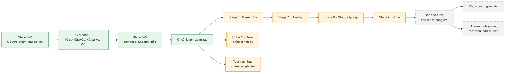

# Đặc tả bài học LingoBites (đã có và sắp làm)

> Cập nhật: 2026-10-11 · Đối chiếu với code `main` @ `0c5f647` (app) và module `moments`, `evaluation`, `curriculum` (server).
> Đây là **tài liệu đọc đầu tiên** về bài học. Plan chi tiết từng PR đã chuyển vào
> [`docs/superpowers/archive/`](../superpowers/archive/), mục 9 có chỉ mục để tra sâu.
> Công cụ soạn bài cho team nội dung vẫn để riêng:
> [`content/lesson-spec-template.md`](../content/lesson-spec-template.md) (bài mẫu
> [`examples/lesson-spec-order-a-drink.md`](../content/examples/lesson-spec-order-a-drink.md)).

Ký hiệu: ✅ đã chạy trong app · 🟡 có một phần · ⏳ sắp làm (có thiết kế) · 💭 ý tưởng (chưa có thiết kế)

---

## 1. Tổng quan

LingoBites có **5 loại bài** dùng chung một trình phát. Mọi tính năng mới gắn vào một trong 3 "ổ cắm"; gắn đúng ổ là player, ôn tập, flashcard, Today dùng được ngay.

Mọi lượt làm đều ghi vào `activity_attempts` (sync qua outbox) với `kind = lesson | practice | review | game`. Chỉ `kind = review` mới dời lịch ôn, nên game và luyện tập tự do không làm lệch lịch ôn.

### 1.1 Năm loại bài

| # | Loại bài | Nguồn (`source_type`) | Có đặc tả (spec) | Màn học | Cách hoàn thành | Vào lịch ôn | Trạng thái |
|---|---|---|---|---|---|---|---|
| ① | **Bài giáo trình 6 bước** | `admin_text` | ✅ | `LessonFlowPlayer` | Đạt bài = xong phần luyện + bước 5 đạt độc lập | ✅ item `required` | ✅ |
| ② | **Bài tự tạo** (chữ, ảnh chữ, YouTube) | `learner_text`, `learner_ocr`, `youtube` | ❌ | Hub + `Practice` (4 phần) | Làm hết chuỗi luyện (không có "đạt bài") | ❌ (chỉ khi người học bấm "Lưu thành thẻ ôn") | ✅ |
| ③ | **Bài "Học sâu theo 6 bước"** (AI dựng từ câu chọn) | sinh từ bài gốc, nhãn "AI tạo" | ✅ | `LessonFlowPlayer` | Như ① | ❌ (bài người học) | ✅ |
| ④ | **Khoảnh khắc**: Hiểu / Tả / Dùng | `learner_ocr`, `learner_text`, `learner_situation` | Tả, Dùng: ✅ · Hiểu: ❌ | Hiểu: như ② · Tả, Dùng: như ③ | Như ② hoặc ③ | ❌ | ✅ |
| ⑤ | **Nhiệm vụ tổng hợp Unit** | admin | ✅ | `UnitSummativeTask` | Đạt unit = đạt mọi bài + đạt nhiệm vụ | — | ✅ |

---

## 2. Mô hình bài học (thiết kế ngược)

Bài được soạn theo chiều **đầu ra → bằng chứng → hoạt động**:
mục tiêu can-do → nhiệm vụ vận dụng và tiêu chí → item → hoạt động 6 bước → ôn.

- **Item** (danh mục dùng chung): `word`, `phrase`, `pattern` (mẫu câu có chỗ trống), `pronunciation`, `listening`. Mã ổn định, ví dụ `pattern:can-i-have`, `word:coffee`.
- **Hoạt động** gắn: bước (1–6), hình thức Speak/Listen/Write, thời lượng thiết kế. Tỷ lệ tham chiếu theo unit **70 / 25 / 5 ± 10** (chỉ cảnh báo ở admin).
- **Rubric 4 tiêu chí**: đúng mục đích · có nội dung trọng tâm · đủ rõ · độc lập.
- **Thang gợi ý** 0–4: không gợi ý · nghe lại · từ khoá / hình · khung câu · câu mẫu. Mức cao nhất đã dùng = **mức hỗ trợ** của lượt.
- Nội dung hiện có (Giai đoạn 2): **14 unit / 42 bài** A1 + A2, mỗi unit có nhiệm vụ tổng hợp (`yarn seed:curriculum`).

Chi tiết từng trường: [`content/lesson-spec-template.md`](../content/lesson-spec-template.md).

---

## 3. Vòng học chung

### 3.1 Bốn kết quả của một lượt

| Kết quả | Ý nghĩa | App làm gì |
|---|---|---|
| `pass_independent` | Đạt, không cần gợi ý vượt ngưỡng | Ghi đạt; item vào lịch ôn |
| `pass_with_support` | Đạt nhưng dùng gợi ý | Ghi "còn cần hỗ trợ", mời thử lại độc lập |
| `not_yet` | Chưa đạt | Chỉ lỗi chính, cho luyện lại |
| `not_assessable` | Lỗi âm thanh / xử lý | Yêu cầu làm lại, **không tính là sai** |

### 3.2 Năm mức hoàn thành

- `passed_at` đặt **một lần, không lùi**. Quên item chỉ đánh dấu "cần ôn", không xoá "đạt bài".
- Streak / thời gian học tách riêng khỏi "đạt bài". Bỏ qua hoặc tạm dừng không tính là đạt.
- Server là nguồn đúng (`lesson_outcomes`, `unit_outcomes`, `item_memory`); offline thì app tự tính cùng luật và hiện "chờ xác nhận".

---

## 4. ① Bài giáo trình 6 bước ✅

**Sáu loại hoạt động** (`features/lesson/flow/components/activities/`):

| Hoạt động | Chấm |
|---|---|
| `listen_and_repeat` · `speaking_drill` · `role_play` | Ghi âm, nghe lại cạnh câu mẫu, tự đánh giá |
| `multiple_choice` · `fill_blank` · `translation` | App tự chấm theo `acceptedAnswers` / `normalizeAnswer` |

**Bước 5:**
- Câu viết gửi server chấm ngay (`POST /v1/evaluations/text`, giới hạn theo ngày).
- Câu nói ghi âm AAC 16 kHz, upload mode `lesson_task`, server STT rồi chấm (chữ nhận dạng không lưu, file xoá sau 30 ngày). Chỉ chạy khi người học đồng ý "Chấm bài nói bằng máy".
- Nút "Không nói được lúc này" cho phép viết thay, nhưng **không** tính đạt bài.
- ⚠️ Chấm nói **chưa test trên máy thật**.

Code chính: `features/lesson/flow/` (`useLessonFlow`, `practiceCompletion`, `lessonOutcome`, `hints`, `taskEvaluation`), server `modules/evaluation`, `modules/curriculum`.

---

## 5. ② Bài tự tạo + chuỗi luyện trên máy ✅

- Chuỗi sinh trên máy từ dữ liệu bài (`core/learning/lessonPractice.ts`, `practice.ts`); áp dụng cả bài cũ.
- **Bài dài chia đoạn** (`lessonPracticeSegments`): mỗi đoạn tối đa 8 câu, chia đều theo thứ tự (17 câu → 6, 6, 5). Bài ≤ 8 câu là một đoạn.
  - "Bắt đầu luyện" mở đoạn chưa luyện tiếp theo (1 → 2 → 3); luyện hết thì quay lại đoạn luyện lâu nhất. Hub đổi nhãn thành "Luyện tiếp · đoạn N/M".
  - Màn kết quả: "Đã luyện X/M đoạn", nút "Luyện đoạn tiếp theo", danh sách "Chọn đoạn khác" (câu đầu, khoảng thời gian video, đã luyện, đoạn ít nội dung bị mờ).
  - Đoạn đã luyện lưu **trên máy** (`app_settings`, khoá `practice.segments.<lessonId>`, theo `content_revision`), không sync. Gợi ý "Học sâu theo 6 bước" lấy câu từ đoạn vừa luyện.
- Phần nào thiếu dữ liệu thì bỏ; còn dưới 2 phần thì giữ nút ✓ một chạm.
- Tắt luyện nói (`noSpeaking`) thì bỏ phần 1, không chặn hoàn thành.
- Không có ngưỡng điểm: điểm chỉ để hiển thị và chọn từ cần ôn.

**Bài YouTube** dùng thêm giao diện học video (`YouTubeLessonStudy`, carousel câu, transcript, phân tích câu, tốc độ phát). Phần còn thiếu so với thiết kế ở mục 8.2.

---

## 6. ③ "Học sâu theo 6 bước" từ câu đã chọn ✅

- Chọn câu được trên bài của chính người học và bài chung chưa có 6 bước. Bài đã sinh ra thì không chọn tiếp.
- Chọn **1–8 câu**; kiểm tra trước (không gọi AI, không tính lượt): mỗi câu ≤ 300 ký tự, tổng ≥ 8 từ (mỗi câu khác nhau đếm một lần), không quá nửa là câu cụt.
- AI (prompt `lesson.compose`) chọn câu thuộc **một tình huống**, rồi sinh can-do, item, 1–2 mẫu câu có chỗ trống, nhiệm vụ có hướng dẫn, nhiệm vụ độc lập (đổi chi tiết) và **nhập vai 4–8 lượt** ở bước 5. Câu trả lời sai định dạng được gửi lại AI sửa một lần.
- Nội dung **độc thoại** (vlog, bài nói, kể chuyện): prompt v2 biến thành tình huống "kể cho bạn bè / đồng nghiệp nghe" (người kia hỏi, người học trả lời bằng mẫu câu). Chỉ từ chối lời bài hát, thơ, danh sách, mảnh câu. Runbook kích hoạt v2: `LingoBites-Server/docs/03-operations/compose-prompt-v2.md`.
- Hạn mức: `COMPOSE_LEARNER_DAILY_LIMIT` (mặc định 1 / ngày), trần số lần gọi AI theo tháng `COMPOSE_MONTHLY_CALL_CAP`. Tính lượt khi bài dựng xong, khi AI trả sai định dạng (`COMPOSE_AI_INVALID`) hoặc bài không qua spec-check. **Không** tính khi "không phù hợp" (`COMPOSE_NOT_SUITABLE`), quá thời gian hay lỗi nhà cung cấp.
- Sắp làm (chờ duyệt): bước 5 dạng "kể lại bằng lời của bạn" cho bài độc thoại thay cho nhập vai, xem `superpowers/plans/2026-10-11-compose-monologue-lessons.md`.
- Bài YouTube: bước 2 phát đúng đoạn video (`startMs` / `endMs`).
- Màn chờ theo nguyên tắc "gửi xong là đi tiếp": bài tự về, thất bại thì nói rõ lý do và có việc làm tiếp.

---

## 7. ④ Khoảnh khắc: "Học từ đời thường" ✅

Một lối vào, hỏi một câu **"Bạn muốn làm gì?"**. Ý định quyết định dạng bài, không phải loại đầu vào.

| Ý định | Đầu vào | Ra bài | Hạn mức |
|---|---|---|---|
| **Hiểu** | Ảnh có chữ / chữ dán | Giữ nguyên nội dung gốc, tóm tắt tiếng Việt, lọc dòng rác OCR | Hạn mức "Hiểu" riêng theo ngày (reset 0h giờ VN) |
| **Tả** | Ảnh cảnh vật / đồ vật | 6 bước, hub hiện ảnh gốc, 2 nhiệm vụ "tả lại" | Hạn mức compose |
| **Dùng** | Tình huống (danh mục / tự gõ) ± ảnh | 6 bước, hội thoại dùng chữ thật trong ảnh nếu có | Hạn mức compose |

**An toàn và riêng tư:**
- Kiểm duyệt ảnh (SafeSearch) và chữ (`moderateText`). Bị chặn thì **không tính lượt**.
- Thông tin cá nhân (số điện thoại, email, dãy số dài): chỉ **cảnh báo**, người học tự ẩn dòng.
- Kiểm magic bytes, đổi HEIC sang JPEG. Ảnh tạm xoá sau 24 giờ nếu không tạo bài; ảnh đã tạo bài xoá cùng bài hoặc tài khoản.
- Có màn đồng ý lần đầu. Nội dung người học được nhúng như dữ liệu trong prompt để chống prompt injection.
- **Tài khoản trẻ em không tạo bài** từ bất kỳ nguồn nào.

**Admin** (`admin-web`): xem ảnh người học (có audit), hàng đợi từ bị báo sai, soạn danh mục tình huống, thống kê khoảnh khắc, chỉnh prompt `moment.use` / `moment.describe`.

Code chính: app `features/input/` (`MomentReviewScreen`, `SituationInputScreen`, `CreateScreen`); server `modules/images`, `modules/moments`, `modules/situations`.

---

## 8. Sắp làm

### 8.1 Game Hub và 3 nhóm game ⏳ (Stage 6–9)

Thiết kế: [`superpowers/plans/2026-10-10-stage5-9-image-lesson-game-hub.md`](../superpowers/plans/2026-10-10-stage5-9-image-lesson-game-hub.md) §3–5. Chưa có plan chi tiết từng PR; cần chốt câu hỏi §5 của file đó.

| Stage | Nhóm | Game | Dữ liệu dùng lại |
|---|---|---|---|
| 6 | **Game Hub** | Sảnh game, contract `generate` / `grade`, lượt `kind = 'game'` | `activity_attempts` |
| 7 | Hỏi–đáp | `meaning_quiz`, `blank_quiz`, `true_false` | `practice.ts` |
| 8 | Ghép, sắp xếp | `meaning_match`, `sentence_order`, `drag_fill` | từ vựng, câu, `patternFrame` |
| 9 | Nghe | `listen_choice`, `listen_type` | TTS, `acceptedAnswers` |

- Game chơi offline với bài đã tải, item đến hạn và thẻ đã lưu. Từ sai lưu được thành flashcard. Game **không** đổi lịch ôn.
- Không thêm dependency: kéo thả dùng `react-native-gesture-handler` + `reanimated` sẵn có.
- Để sau: `tense_quiz` (chưa có dữ liệu ngữ pháp có cấu trúc), `flashcard_challenge`.

### 8.2 UI bài YouTube: phần còn thiếu 🟡

Thiết kế: [`superpowers/specs/2026-10-02-youtube-lesson-ux-redesign.md`](../superpowers/specs/2026-10-02-youtube-lesson-ux-redesign.md) + bộ màn [`design/youtube-lesson/`](../design/youtube-lesson/README.md).
Đã có: màn học video, carousel câu, transcript, phân tích câu, tốc độ phát, mục video trong thư viện (`VideoHub`).
Chưa thấy trong code: lặp A–B, màn "Học xong bài" riêng cho video. Cần rà lại 12 màn FR-01…FR-12 trước khi lập plan.

### 8.3 Việc kiểm thử còn nợ ⏳

- Chấm bước 5 (ghi âm, upload, STT) và tự đánh giá nói: chưa test trên máy thật.
- Gỡ EXIF / GPS của ảnh: cần kiểm trên máy thật xem `react-native-image-picker` đã bỏ chưa.

### 8.4 Ý tưởng chưa có thiết kế 💭 (lộ trình 8 bước, Bước 7–8)

| Nhóm | Nội dung | Ghi chú |
|---|---|---|
| Báo cáo | Báo cáo theo tuần, câu mô tả năng lực, tách "học đều" với "dùng tốt" | Đã có `ProgressReportScreen` cơ bản |
| Vai trò | Phụ huynh xem tiến độ con, giáo viên / phụ huynh đề xuất bài, consent phụ huynh | Cố ý bỏ ở Giai đoạn 2 |
| Động lực | Rule thưởng gắn "đạt bài", nhiệm vụ, câu chuyện, mở khoá | Hiện chỉ có XP, streak, pet, badge |
| Thực hành mở rộng | Nhập vai AI tự do, đấu bot / người, nhiệm vụ đội | Phải dùng rubric của bài khi tính đánh giá |
| Nội dung | Pre-A1 cho trẻ, B1, nhóm 12–15 tuổi; nguồn bài hát / phim | Trẻ em hiện chỉ học bài giáo trình |
| Kinh doanh | Gói thuê bao, family, referral, thanh toán store | Đã có quyền theo khoá học |
| Vận hành | Admin cấu hình tiêu chí đạt, rule thưởng; push nhắc học dẫn thẳng tới bài | Đã có chỉnh khoảng ôn, prompt AI |

**Rule liên kết** (áp cho mọi tính năng mới): game, câu chuyện, nhiệm vụ phải chỉ rõ hoạt động tiếng Anh đi kèm; thưởng và bảng xếp hạng không thay thế đánh giá năng lực; bài từ nguồn mở rộng có mục tiêu thì phải có tiêu chí.

---

## 9. Chỉ mục tài liệu chi tiết (đã lưu trữ)

Các file dưới đây nằm trong [`docs/superpowers/archive/`](../superpowers/archive/). Mỗi plan có mục "Kết quả / điểm lệch so với plan" ghi lại các quyết định thật.

| Chủ đề | File (`archive/plans/`) |
|---|---|
| Yêu cầu gốc, lộ trình 8 bước | `2026-10-07-learning-cycle-requirements-roadmap.md` |
| Plan tổng thiết kế ngược (Stage 0–3) | `2026-10-07-backward-design-curriculum-plan.md` |
| Cấu hình Bước 0 (ngưỡng, khoảng ôn, 70/25/5…) | `2026-10-09-phase2-step0-config.md` |
| Item, đặc tả, task (server, admin) | `pr1` … `pr4`, `pr7` |
| Contract app, hub, player 6 bước, gợi ý | `pr5`, `pr6`, `pr8` … `pr11` |
| Âm thanh, chấm bài, đạt bài, ôn | `2026-10-08-stage3-audio-evaluation-analysis.md`, `2026-10-09-phase1-stage3-plan.md`, `pr12` … `pr17` |
| Hồ sơ, đầu vào, nội dung A1–A2 | `2026-10-09-phase2-product-trial-plan.md` |
| Compose 6 bước, prompt AI, màn chờ | `2026-10-09-s4-*.md` |
| Khoảnh khắc | `2026-10-10-everyday-learning-redesign.md`, `2026-10-10-e0` … `e6` |
| Chuỗi luyện bài tự tạo | `2026-10-11-self-created-lesson-practice.md`, `2026-10-11-practice-segments.md` (chia đoạn) |
| Backlog, bảng chốt quyết định Q/D | `2026-10-08-remaining-work-plan.md`, `2026-10-08-backlog-remaining-work.md` |
| Cổng vào bài học, điều hướng | [`lesson-entry-points.md`](./lesson-entry-points.md), [`navigation.md`](./navigation.md) |
| Tính năng đang chạy (toàn app) | [`feature-map.md`](./feature-map.md) |
