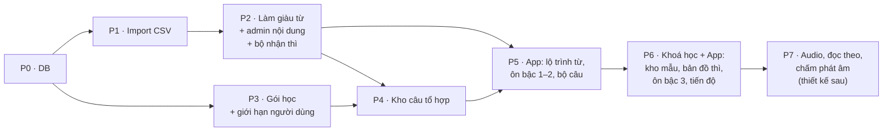

# Kế hoạch P2 → P7: Lộ trình Từ · Mẫu câu · Thì

> Trạng thái: **P2–P5 ĐÃ CODE. P6 chưa code. P7 chưa thiết kế.** Rà lại ngày 2026-10-15, bảng trạng thái ở §0. Phần mô tả từng giai đoạn bên dưới giữ nguyên như lúc lập plan.
> Thiết kế: [`vocab-pattern-tense-path.md`](./vocab-pattern-tense-path.md) · Kế hoạch trước: [`2026-10-11-vocab-pattern-tense-p0-p1.md`](../superpowers/archive/plans/2026-10-11-vocab-pattern-tense-p0-p1.md).
> Mỗi giai đoạn sẽ được lập kế hoạch chi tiết lại (danh sách file cuối cùng) ngay trước khi bắt đầu code, dựa trên code thật lúc đó.

## 0. Tổng quan

| GĐ | Repo | Thay đổi DB | Gọi AI | Phát hành App |
|---|---|---|---|---|
| P2 | Server, admin-web | Nhỏ (bảng job) | ✅ ~110 lần (một lần) | Không |
| P3 | Server, admin-web | ✅ 4 bảng | Không | Không |
| P4 | Server, admin-web | ✅ 4 bảng | ✅ theo người dùng | Không |
| P5 | Server, App | ✅ server + SQLite trên máy | Không | ✅ |
| P6 | Server, admin-web, App | Nhỏ | ✅ dựng bài (một lần) | ✅ |
| P7 | Chưa xác định | Chưa xác định | Chưa xác định | ✅ |

P3 không phụ thuộc P2 nên có thể làm song song.

### Trạng thái (rà lại 2026-10-15)

| GĐ | Trạng thái | Code chính |
|---|---|---|
| P0, P1 | ✅ Đã code | Server: `019_vocab_import.sql`, `src/modules/imports/`; admin-web: trang Import. Plan đã lưu trữ: [`2026-10-11-vocab-pattern-tense-p0-p1.md`](../superpowers/archive/plans/2026-10-11-vocab-pattern-tense-p0-p1.md) |
| P2 | ✅ Đã code | `020_enrichment_jobs.sql`, `src/modules/wordlist/` (prompt `wordlist.enrich`, `enrichmentWorker`, `validateEnrichment`, `wordFamily`), `src/modules/grammar/detectTense.ts`; admin-web: `EnrichmentPanel`, `GrammarPage` |
| P3 | ✅ Đã code | `021_plans.sql`, `src/modules/plans/` (`resolveLimits`, `usageCounter` / `consumeDaily`, `GET /v1/me/limits`); admin-web: `PlansPage` |
| P4 | ✅ Đã code | `022_combo.sql`, `024_locked_combo_grammar.sql`, `026_combo_polarity_mix.sql`, `src/modules/combo/`; admin-web: các trang Combo (câu, độ phủ, bị báo sai, cài đặt) |
| P5 | ✅ Đã code | Server: `023_word_packs.sql`, `src/modules/wordPacks/` (`/v1/word-path`, `/v1/word-packs/:id`, chặn `grammar` theo phiên bản App). App: `features/wordPath/` (`WordPathScreen`, `WordPackScreen`, `QuickKnownCheckScreen`, `PackLearnScreen`), `features/combo/` (`ComboSetupScreen`, `ComboSetScreen`, `ComboHistoryScreen`), `core/db/catalogItems.ts`, `features/review/logic/itemReviewMix.ts` (60 / 25 / 15, tối đa 2 thẻ cùng loại liền nhau), thẻ so sánh khi sai ≥ 4 lần, thẻ "Gói từ tiếp theo" ở Today, mục "Bộ câu đã học" ở Thư viện |
| P6 | ❌ Chưa code | Chưa có `PatternLibraryScreen`, `TenseMapScreen`, ôn bậc 3 dạng viết, F7, F8, F9, công cụ admin "Tạo unit từ chủ đề" |
| P7 | 💭 Chưa thiết kế | Xem thêm [`superpowers/plans/2026-10-12-pronunciation-architecture.md`](../superpowers/plans/2026-10-12-pronunciation-architecture.md) |

**Điểm lệch so với plan:**
- Số migration khác plan: plan ghi `020_plans` / `021_combo` / `022_word_packs`; code là `020_enrichment_jobs`, `021_plans`, `022_combo`, `023_word_packs`.
- Thêm sau plan: khoá mẫu câu mở bộ câu không cần thì (`024_locked_combo_grammar`), số câu theo khẳng định / phủ định (`026_combo_polarity_mix`), người học chọn nhóm chủ ngữ, nút xoá và dựng lại toàn bộ gói từ trên admin, tên gói và chủ đề tiếng Việt (`029_word_pack_titles_vi`), phân tích ngữ pháp cho câu tổ hợp, lưu câu tổ hợp trên App.
- Mục "Cần chốt" ở cuối file chưa ghi lại quyết định cuối cùng. Câu 3 (khoá học riêng hay gộp) vẫn cần chốt trước P6.

---

## P2. Làm giàu từ vựng, admin nội dung, bộ nhận thì

### Mục tiêu
- 5.323 dòng từ vựng trong hàng chờ trở thành item có nghĩa tiếng Việt, 2 ví dụ, chủ đề và collocation.
- Admin duyệt và publish hàng loạt được.
- Có **bộ nhận thì** (detect tense) dùng chung cho trang Thì (ô "Thử câu") và cho kiểm tra câu tổ hợp ở P4.

### Server

**1. Prompt `wordlist.enrich`** (đăng ký vào `PROMPT_REGISTRY` ✅, có case mẫu):

| Đầu vào (mỗi lần ≤ 50 từ) | Đầu ra (mỗi từ) |
|---|---|
| `code`, `headword`, `pos`, `sense`, `cefr` | `meaning_vi` (đúng loại từ và nghĩa phân biệt) |
| Danh sách tag chủ đề được phép | `examples[2]` `{en, vi}`, độ dài theo cấp |
| | `topics[]` (chỉ lấy trong danh sách) |
| | `collocations[≤3]` `{text, meaning_vi}` |
| | `note_vi` (tuỳ chọn: lưu ý cách dùng) |

Case mẫu bắt buộc phải bao: từ nhiều nghĩa (`bank-money` / `bank-river`), cùng chữ khác loại từ (`close1-v` / `close2-adj`), từ chức năng (`a/an`, `the`), cụm (`according to`), từ C1 trừu tượng.

**2. Kiểm tra kết quả** (không gọi AI):
- Ví dụ phải chứa từ đó hoặc một dạng biến đổi của nó (dùng bộ biến hình ở mục 4 dưới đây).
- Độ dài ví dụ theo cấp.
- `topics` nằm trong danh sách cho phép.
- Collocation phải chứa từ gốc.
- `moderateText` ✅.

Sai thì đánh dấu dòng `failed` kèm lý do; được thử lại tối đa 2 lần.

**3. Job làm giàu** (`enrichment_jobs` 🆕):
- Bảng gồm: id, người chạy, bộ lọc, trạng thái, total / done / failed, số lần gọi AI, thời gian bắt đầu / kết thúc.
- Worker theo đúng mẫu `LessonCreationWorker` / `EvaluationWorker` ✅ (tick + lease). Chạy 1 lô mỗi lần, có nút **tạm dừng / chạy tiếp**.
- Thứ tự: A1 → C1, trong mỗi cấp theo thứ tự chữ cái (danh sách Oxford không có thứ hạng tần suất). Theo quyết định: **làm tất cả các cấp trong 1 job**.
- Mỗi dòng thành công tạo:
  - item `draft`, `source = ai`
  - `item_examples`
  - `item_tags` (cấp, danh sách, chủ đề)
  - các `phrase` collocation (tạo mới hoặc dùng lại) + `item_links (collocation)`
- Số lần gọi AI được tính vào trần chi phí tháng có sẵn (`COMPOSE_MONTHLY_CALL_CAP` đang đếm `ai_prompt_runs`).

**4. Bộ biến hình và nhận thì** (`src/modules/grammar/`, không gọi AI):
- `inflect.ts`: dạng `-s`, `-ed`, `-ing` theo luật chính tả, cộng một **bảng động từ bất quy tắc** (~200 động từ, file dữ liệu trong repo).
- `detectTense.ts`: tách câu thành từ → tìm cụm động từ chính → khớp với `payload.check` của 13 item `grammar`. Trả về `{tense_code, confidence, matched_tokens}`.
- Với mẫu có mệnh đề (`It is worth noting that {clause}`), nhận thì **của mệnh đề**.
- Bộ test ≥ 150 câu mẫu (mỗi thì ≥ 10 câu khẳng định / phủ định / câu hỏi + các ca dễ nhầm như *has* sở hữu vs *has* trợ động từ, *'s* = is / has).

**5. Họ từ (word family), không gọi AI:** ghép các từ cùng gốc trong danh sách Oxford theo hậu tố (`-tion`, `-ment`, `-er`, `-ly`, `-ness`, `-al`, `-ful`, `-less`, `-ize`…), tạo `item_links (word_family)`. Ưu tiên ít mà đúng: chỉ ghép khi gốc dài ≥ 4 ký tự và cả 2 từ đều có trong danh sách. Admin gỡ được.

**6. Publish:** đề xuất **admin publish theo cấp** sau khi kiểm ngẫu nhiên 5% mẫu, không tự publish.

### Admin-web
| Trang | Nội dung |
|---|---|
| Trang lô import | Nút **Làm giàu**: ước tính số lần gọi AI, chạy, tạm dừng / chạy tiếp, tiến độ, danh sách dòng lỗi + nút thử lại |
| `ItemListPage` | **Thao tác hàng loạt**: publish, gắn / gỡ tag, đổi cấp, archive (chọn nhiều hoặc "tất cả kết quả lọc") |
| `ItemReviewPage` 🆕 | Duyệt nhanh: 1 item / màn, phím tắt `A` duyệt, `E` sửa, `S` bỏ qua; chế độ **mẫu ngẫu nhiên x%** theo lô / cấp |
| `GrammarPage` 🆕 | Lưới 3 × 4 + danh sách; sửa item `grammar`; ô **Thử câu** gọi `POST /v1/admin/grammar/detect` |

### Test
- Unit: `inflect`, `detectTense` (≥ 150 câu), kiểm tra kết quả enrich, ghép họ từ.
- DB: worker (lease, tạm dừng, thử lại, không tạo trùng khi chạy lại), bulk actions, quyền admin.
- admin-web: ItemReviewPage, GrammarPage, bulk actions.
- Thủ công: chạy job thật trên staging với A1 trước để đo tỷ lệ lỗi, rồi mới chạy toàn bộ.

### Chia commit
1. Bộ biến hình + bảng động từ bất quy tắc
2. `detectTense` + route thử
3. Prompt `wordlist.enrich` + case mẫu + kiểm tra kết quả
4. `enrichment_jobs` + worker
5. Ghép họ từ
6. Admin: nút làm giàu, bulk actions, ItemReviewPage, GrammarPage

### Rủi ro
- ⚠️ **Chất lượng nghĩa tiếng Việt** với từ nhiều nghĩa. Giảm bằng case mẫu và kiểm mẫu 5% trước khi publish cả cấp.
- Chi phí: ~110 lần gọi AI cho cả danh sách, cộng các lần thử lại.

---

## P3. Gói học và giới hạn theo người dùng

### Mục tiêu
Mọi giới hạn của câu tổ hợp (hạn ngạch chủ ngữ, số câu, lượt AI…) lấy từ **gói của người dùng**. Ban đầu chỉ có gói `free`, với **10 lượt gọi AI / ngày**.

### Server
**Migration `020_plans.sql`:**
- `plans`, `user_plans`, `user_limit_overrides` (như thiết kế 8.5).
- `usage_daily` (`user_id`, `day` theo giờ VN, `feature`, `count`, PK cả 3 cột).
- Seed gói `free` (`is_default = true`).

**Module `src/modules/plans/`:**
- `limitKeys.ts`: sổ các key giới hạn. Mỗi key có schema zod + mặc định: `combo.subject_quota`, `combo.subject_groups_allowed`, `combo.polarity_allowed`, `combo.batch_sizes`, `combo.max_per_set`, `combo.daily_ai_generations` (= 10), `combo.daily_sets`.
- `resolveLimits(userId)`: ghi đè người dùng > gói (còn hạn) > mặc định trong `admin_settings`. Kết quả ghi rõ mỗi key **lấy từ tầng nào** để admin xem.
- `consumeDaily(userId, feature, limit)`: tăng bộ đếm **nguyên tử** bằng `INSERT … ON CONFLICT DO UPDATE … WHERE count < limit RETURNING`. Không trả hàng = hết lượt. Không thể vượt hạn mức khi 2 request đến cùng lúc.
- Ngày reset lúc 0h giờ Việt Nam, giống hạn mức "Hiểu" hiện có.

**API:**
- `GET /v1/me/limits`: gói, giới hạn hiệu lực, số đã dùng hôm nay.
- Admin: CRUD `plans`; đổi gói / ghi đè cho người dùng (bắt buộc lý do); xem usage. Ghi `admin_audit_log`.

**Không đụng** hạn mức compose hiện có (`users.compose_daily_limit`) ở P3. Gộp vào gói là việc riêng sau này, để tránh ảnh hưởng tính năng đang chạy.

### Admin-web
- `PlansPage` 🆕: danh sách gói, form theo từng key (bảng hạn ngạch chủ ngữ thêm / bớt dòng, ô số, chọn nhiều), xem trước kết quả.
- `UserDetailPage` 🔧: khung "Gói và giới hạn": gói, giới hạn hiệu lực + nguồn, usage hôm nay, đổi gói, thêm / gỡ ghi đè.

### Test
- Unit: gộp 3 tầng, schema từng key, giờ VN.
- DB: `consumeDaily` chạy song song 20 request với limit 10 thì đúng 10 thành công; gói hết hạn quay về `free`; quyền admin; audit log.

### Rủi ro
- ⚠️ Đây là nền cho mọi tính năng có hạn mức sau này. Sai thì người dùng bị chặn nhầm hoặc vượt chi phí. Giảm bằng test song song và log mỗi lần từ chối.

---

## P4. Kho câu tổ hợp

### Mục tiêu
Server trả về bộ câu theo **item + tình huống + thì + số câu**, chia theo hạn ngạch chủ ngữ. Lấy câu từ kho trước, thiếu thì gọi AI, có "tải thêm". Admin quản lý được kho câu.

### Bổ sung vào dữ liệu P1
Mẫu câu cần thêm trường **`tense_mode`** (đã thêm cột vào `ielts-patterns.csv` ở bản gửi kèm):

| Giá trị | Ý nghĩa | Ví dụ |
|---|---|---|
| `free` | Thì áp vào động từ chính | `{subject} place a heavy emphasis on {thing}` |
| `clause` | Phần đầu cố định; thì áp vào mệnh đề | `It is worth noting that {clause}` |
| `locked` | Không đổi thì; ẩn chọn thì trong app | `It is essential that` (động từ nguyên mẫu), `should not be underestimated` |

### Server
**Migration `021_combo.sql`:** `combo_sentences`, `combo_sets`, `combo_set_sentences`, `combo_reports` (như thiết kế 3.4); `status` chỉ có `published / flagged / archived`.

**Module `src/modules/combo/`:**

| File | Việc |
|---|---|
| `model/subjectGroups.ts` | Các nhóm chủ ngữ, từ mẫu cho từng nhóm (I; He/She xen kẽ; They; We; You; noun_phrase lấy từ slot `subject.values` của mẫu hoặc AI chọn) |
| `model/quotaPlanner.ts` | Hạn ngạch hiệu lực = giới hạn gói ∩ nhóm hợp với item (`combo_subject_groups`) ∩ nhóm người dùng chọn. Lập thứ tự phát theo vòng, giữ `next_cursor` cho "tải thêm". |
| `service/poolLookup.ts` | Lấy câu `published` theo (item, thì, tình huống, nhóm), bỏ câu đã phát trong bộ |
| `prompts/comboGenerate.ts` | Prompt `combo.generate` + case mẫu (mục 8.6 thiết kế) |
| `service/validateSentence.ts` | Kiểm tra mục 4.4: có item (dùng `inflect`), đúng chủ ngữ, đúng thì (`detectTense`, tôn trọng `tense_mode`), hoà hợp chủ–động từ, độ dài, từ vượt cấp (tra cấp Oxford), `moderateText`, cờ `natural` |
| `service/ipaTokens.ts` | Tách câu → token + IPA (cmudict ✅ + LLM dự phòng ✅) + vai trò |
| `service/buildSet.ts` | Ghép: lập kế hoạch → lấy từ kho → thiếu thì `consumeDaily` → gọi AI → kiểm tra → lưu kho → trả bộ |
| `controller/comboRoutes.ts`, `controller/adminCombo.ts` | API người học và admin |

**Chống sinh trùng khi 2 người cùng yêu cầu một tổ hợp:** khoá `pg_advisory_xact_lock(hash(item, thì, tình huống))`. Người đến sau chờ rồi lấy câu từ kho. Có thêm unique index trên câu.

**Thời gian chờ:** sinh câu đồng bộ trong request, timeout 25 giây. Quá giờ thì trả phần đã có trong kho kèm thông báo "đang tạo thêm, thử tải thêm sau". Lượt AI **chỉ tính khi thành công**, giống compose hiện có.

**Tài khoản trẻ em:** chỉ lấy câu trong kho, không gọi AI. Đề xuất để an toàn; đổi được bằng gói sau.

**API người học:**

| Method | Path |
|---|---|
| GET | `/v1/combo/options?item=` → các thì được chọn (theo `tense_mode`), nhóm chủ ngữ, số câu (theo gói) |
| GET | `/v1/combo/situations?item=` |
| POST | `/v1/combo/sets` |
| POST | `/v1/combo/sets/:id/more` |
| GET | `/v1/combo/sets` (lịch sử), `/v1/combo/sets/:id` |
| POST | `/v1/combo/sentences/:id/reports` |

**Admin:**
- Danh sách câu, lọc, sửa (chạy lại kiểm tra + IPA), archive, **archive theo phiên bản prompt**, thêm câu tay.
- Ma trận độ phủ; hàng đợi báo sai.
- **Sinh trước** theo bài / unit / item, chạy bằng worker; tính vào ngân sách hệ thống, không tính vào lượt của người dùng.
- Upload CSV câu tổ hợp (loại import thứ 5).
- `ComboSettingsPage`: các tham số chất lượng.

### Test
- Unit: `quotaPlanner` (gói × item × chọn của người dùng, vòng he/she, cursor khi tải thêm), `validateSentence` (≥ 80 câu đúng / sai), `ipaTokens`.
- DB: lấy từ kho trước, không trùng khi 2 request song song, hết lượt AI, tải thêm tới `max_per_set`, báo sai ≥ ngưỡng → `flagged`, trẻ em không gọi AI.
- Prompt: chạy thử case mẫu đạt ngưỡng trước khi kích hoạt.

### Rủi ro
- ⚠️ **Chi phí AI**: được chặn bởi gói (10 lần / ngày / người) + trần tháng.
- ⚠️ **Chất lượng câu khi không duyệt tay**: được giữ bởi case mẫu, kiểm tra tự động, báo sai và archive theo phiên bản prompt.
- Nhận thì sai với câu phức: `detectTense` trả `confidence` thấp thì loại câu, thà thiếu câu hơn phát câu sai thì.

---

## P5. App: lộ trình từ, ôn bậc 1–2, bộ câu tổ hợp

### Phát hiện quan trọng
App hiện **chỉ lấy nội dung item từ các bài đã tải** (`itemContents()` đọc `lesson_downloads`, quyết định G7). 5.000 từ phần lớn không nằm trong bài nào, nên cần thêm **gói từ tải về máy**.

### Server
- Migration `022_word_packs.sql`: `word_packs` (id, cefr, topic tag, position, title_vi) + `word_pack_items`.
- Admin có nút **"Dựng gói từ"**: chia item đã publish theo cấp × chủ đề, mỗi gói ~12 từ. Gói đã dựng thì giữ nguyên, không xáo lại khi thêm từ mới; từ mới vào gói mới.
- `GET /v1/word-path` (cấp → chủ đề → gói + số từ), `GET /v1/word-packs/:id` (danh sách `CatalogItem`, đúng format App đang đọc).
- **Mở chặn `grammar`** trong bài học và trong gói, nhưng chỉ gửi cho App từ phiên bản hỗ trợ `grammar` trở lên (dựa vào header phiên bản App; app cũ không nhận item `grammar`).
- Kiểm `item_memory` sync nhận được item không thuộc bài nào. Nếu chưa thì sửa.

### App
**Dữ liệu trên máy** (tăng phiên bản schema trong `src/core/db/migrations.ts`):
- `catalog_items` (code, item_json, source, updated_at)
- `word_pack_downloads`
- `combo_sets_local` (để học lại offline)

Các phần sửa:
- `itemContents()` 🔧: đọc thêm `catalog_items` khi item không có trong bài.
- `CatalogItemKindValues` 🔧: thêm `grammar`.
- `itemPayload.ts` 🔧: đọc payload `grammar`.

**Màn hình:**

| Màn | Nội dung |
|---|---|
| `WordPathScreen` 🆕 | Cấp → chủ đề → gói, % đã nhớ, gói tiếp theo được gợi ý |
| `WordPackScreen` 🆕 | Danh sách từ, nút **Học gói này**, nút **Kiểm tra nhanh** |
| `QuickKnownCheck` 🆕 | 10 câu chọn nghĩa. Từ đúng 2 lần → vào lịch ôn ở bậc 2 (vẫn được ôn lại một lần, không bỏ hẳn) |
| `PackLearnSession` 🆕 | Thẻ giới thiệu (nghĩa, IPA, ví dụ, collocation) → bài bậc 1 → từ vào `item_memory`, sync qua outbox ✅ |
| `ItemReviewScreen` 🔧 | Dạng bài theo bậc (bậc 1: nhận ra; bậc 2: nhớ lại) cho cả 3 loại item; chọn đáp án nhiễu cùng gói / cấp / loại từ |
| `ComboSetupSheet` 🆕 | Tình huống, thì (ẩn khi `locked`), nhóm chủ ngữ, số câu, lượt AI còn lại |
| `ComboSetScreen` 🆕 | Câu theo nhóm chủ ngữ, tô màu item / động từ, chạm vào từ xem IPA + nghĩa, bật / tắt dòng VI, **Tải thêm**, **Báo sai** |
| Thư viện 🔧 | Mục "Bộ câu đã học" |
| Today 🔧 | Thẻ "Gói từ tiếp theo" |

Lối vào bộ câu: từ thẻ ôn, từ hub bài học (mục từ / mẫu), từ gói từ.

**Hàng ôn** (`itemReviewQueue`) 🔧:
- Tỷ lệ ~60 / 25 / 15 (từ / mẫu / thì).
- Không quá 2 thẻ cùng loại liền nhau.
- Đếm số lần sai trên máy (thêm cột `lapses` local); sai ≥ 4 lần thì hiện thẻ so sánh trước khi hỏi.

### Test
- Jest: tăng schema SQLite và giữ dữ liệu cũ, `itemContents` đọc 2 nguồn, bộ sinh bài ôn từng bậc, luật trộn hàng ôn, QuickKnownCheck, ComboSetScreen (tải thêm, báo sai, offline).
- Server: word-path / word-packs, chặn `grammar` với app cũ.
- Thủ công: chạy trên máy thật (iOS + Android) trước khi phát hành.

### Rủi ro
- ⚠️ **Tăng phiên bản DB trên máy**: phải giữ nguyên dữ liệu người học. Có test nâng cấp từ phiên bản hiện tại.
- ⚠️ **App cũ gặp `grammar`**: chặn ở server theo phiên bản App.
- Phát hành qua store mất thời gian duyệt, nên server phải tương thích ngược.

---

## P6. Khoá học + App: kho mẫu, bản đồ thì, ôn bậc 3, tiến độ

### Khoá học "Oxford 3000 + IELTS" (Server, admin)
Phần này chưa có ở các giai đoạn trước: **dựng khoá học thật** gồm unit theo chủ đề, bài, nhiệm vụ tổng hợp.
- Admin có công cụ **"Tạo unit từ chủ đề"**: chọn cấp + chủ đề → hệ thống đề xuất 4 bài (mỗi bài ~12 từ + 1 mẫu + 1 thì + 1–2 tình huống) → dùng `lessonComposer` ✅ để dựng bài 6 bước → admin sửa → publish.
- Sinh trước câu tổ hợp cho các bài (P4).
- Quy mô ~60–65 unit. Đề xuất dựng theo đợt và kiểm từng đợt.

### App
| Màn | Nội dung |
|---|---|
| `PatternLibraryScreen` 🆕 | Lọc theo chức năng, cấp, kỳ thi; mỗi mẫu có ví dụ, nút "Luyện câu tổ hợp", "Thêm vào ôn" |
| `TenseMapScreen` 🆕 | Lưới 3 × 4 tô màu theo mức nhớ → chi tiết thì |
| Ôn bậc 3 (dạng viết) 🔧 | Câu VI → **sắp xếp từ** thành câu EN; **đổi chủ ngữ** → gõ động từ đã chia. Câu lấy từ các bộ câu người học đã mở; chấm offline. |
| F8 · Bắt từ trong bài tự tạo 🔧 | Server thêm `item_code` + `cefr` vào phần từ vựng của câu; App hiện nhãn cấp + nút "Thêm vào lộ trình" |
| F9 · Tiến độ 🔧 | `ProgressReportScreen`: đã nhớ x / 5.000 từ theo cấp, mẫu theo chức năng, lưới thì |
| F7 · Viết đoạn cuối tuần 🔧 | Nhiệm vụ tổng hợp có danh sách item bắt buộc; App đếm và đánh dấu ngay khi người học viết |

### Rủi ro
- Dựng 60+ unit là khối lượng nội dung lớn. AI hỗ trợ nhưng vẫn cần người kiểm.

---

## P7. Audio, đọc theo, chấm phát âm (thiết kế sau)

Theo quyết định, giai đoạn này **thiết kế lại khi tới lượt**. Hiện chỉ ghi phạm vi để không quên:

| Hạng mục | Câu hỏi cần trả lời khi thiết kế |
|---|---|
| Nguồn audio | TTS trên máy (miễn phí, giọng khác nhau) hay server tạo sẵn và lưu cùng câu? Chi phí lưu trữ, cache |
| Đọc theo | Dùng lại `ShadowingSessionScreen` ✅ hay màn riêng? |
| Chấm phát âm | Chấm theo từ (STT có sẵn) hay theo âm vị (dịch vụ mới, có phí theo phút)? Ngưỡng đạt? |
| Ôn bậc 3 dạng nói | Nghe → đọc theo; nhìn câu VI → nói |
| Quyền riêng tư | Áp lại chính sách ghi âm hiện có (đồng ý trước, xoá sau 30 ngày) |

Đầu ra của P7: tài liệu thiết kế + bản thử nghiệm trên máy thật, sau đó mới lập kế hoạch code.

---

## Việc chung cho mọi giai đoạn

- **Tài liệu:** cập nhật [`architecture/lesson-design.md`](../architecture/lesson-design.md) và [`architecture/feature-map.md`](../architecture/feature-map.md) khi tính năng chạy.
- **Theo dõi chi phí AI:** admin xem số lần gọi theo prompt / ngày (dựa trên `ai_prompt_runs` và `usage_daily`).
- **Báo cáo phiên** trong `.ai-logs/reports/`.
- **Mỗi giai đoạn** bắt đầu bằng kế hoạch chi tiết (danh sách file cuối cùng) và chờ duyệt, như P0 + P1.

## Cần chốt (không chặn P0 + P1)

1. **Publish từ vựng sau làm giàu:** admin publish theo cấp sau khi kiểm 5% (đề xuất), hay tự publish ngay?
2. **Tài khoản trẻ em và câu tổ hợp:** chỉ lấy từ kho, không gọi AI (đề xuất)?
3. **Đặt khoá học "Oxford 3000 + IELTS"** là khoá riêng, hay gộp vào khoá "Tiếng Anh giao tiếp" đang có?
