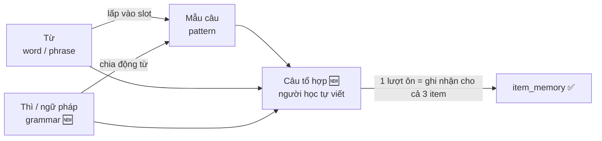
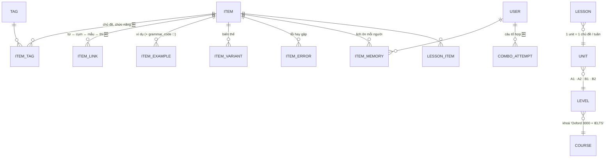
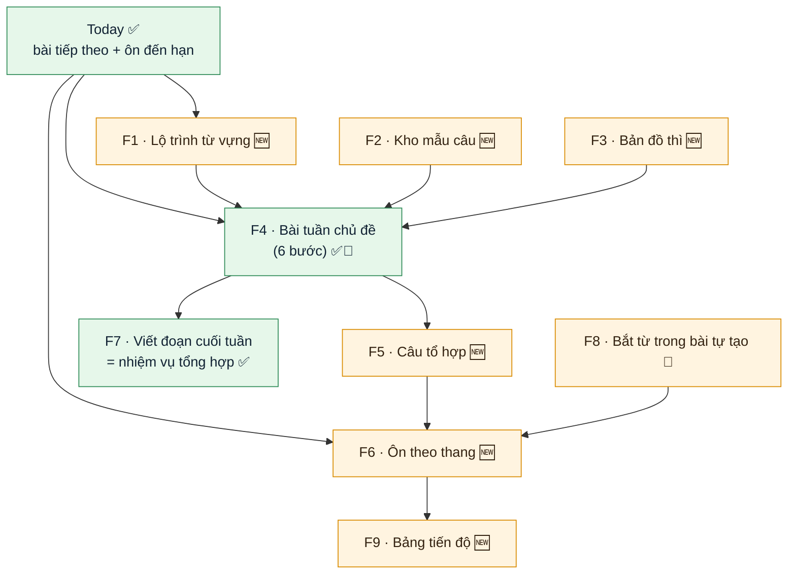
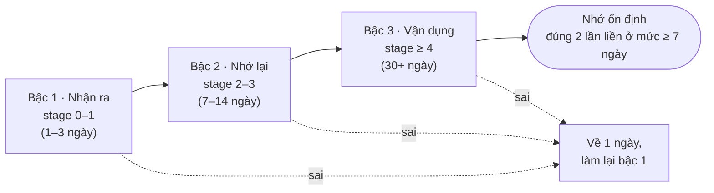
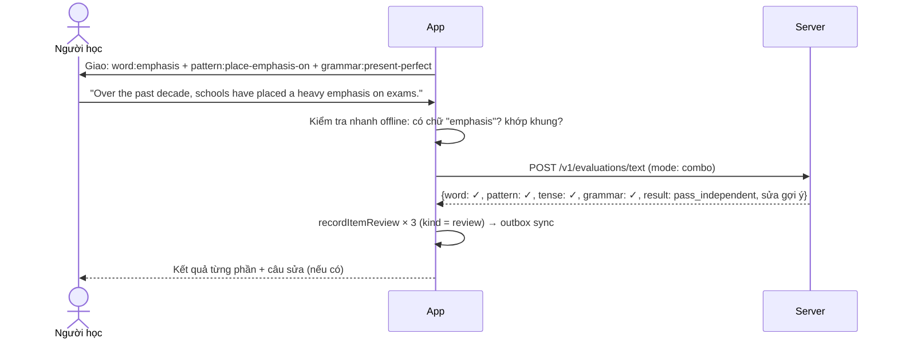
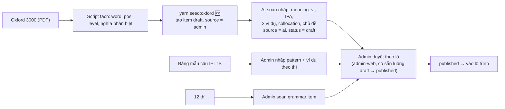

# Thiết kế: Lộ trình Từ · Mẫu câu · Thì

> Trạng thái: **💭 đề xuất, chờ duyệt**. Chưa có code.
> Cập nhật: 2026-10-11. Đối chiếu với [`architecture/lesson-design.md`](../architecture/lesson-design.md)
> và schema server (`items`, `item_memory`, `lesson_items`, `tasks`).
> Nguồn nội dung: danh sách **Oxford 3000** (A1–B2) và bảng **mẫu câu IELTS Writing**.

Ký hiệu: ✅ đã có, dùng lại · 🔧 có rồi, cần mở rộng · 🆕 làm mới

---

## 1. Ý tưởng chính

Người học thường học 3 thứ như 3 danh sách rời: từ, mẫu câu, thì. Thiết kế này nối chúng lại:

- **Từ** là nguyên liệu.
- **Mẫu câu** là khuôn để ghép nguyên liệu.
- **Thì** cho biết câu nói về thời điểm nào.

Mỗi lần luyện ở mức cao nhất là một **câu tổ hợp**: 1 từ + 1 mẫu + 1 thì trong cùng một câu do người học tự viết.



**Nguyên tắc: dùng lại tối đa những gì đã có.**

| Cần | Đã có trong LingoBites |
|---|---|
| Danh mục từ, cụm từ, mẫu câu | `items` với `kind = word / phrase / pattern` ✅ |
| Mẫu câu có chỗ trống, slot trỏ tới từ | `pattern` + `payload.slots[].item_refs` ✅ |
| Ví dụ, biến thể, lỗi hay gặp | `item_examples`, `item_variants`, `item_errors` ✅ |
| Lịch ôn theo người học | `item_memory` (stage, due_at, streak, stable_at) ✅ |
| Khoá → cấp → unit → bài | `courses / levels / units / lessons` + `lesson_items` ✅ |
| Bài 6 bước, nhiệm vụ tổng hợp, rubric | `LessonFlowPlayer`, `tasks`, `task_criteria` ✅ |
| Chấm câu viết | `POST /v1/evaluations/text` ✅ |

Phần thật sự mới chỉ có 4 thứ:
1. Item loại `grammar` (thì và điểm ngữ pháp).
2. Nhãn **cấp độ CEFR** và **chủ đề / chức năng** trên item.
3. Hoạt động **câu tổ hợp**.
4. **Thang bài ôn** theo mức nhớ.

---

## 2. Tổ chức dữ liệu

### 2.1 Mô hình tổng thể



### 2.2 Bảng `items` 🔧: thêm 2 cột và 1 loại

| Thay đổi | Kiểu | Ý nghĩa |
|---|---|---|
| `cefr_level` 🆕 | `varchar(4)` null | `A1`, `A2`, `B1`, `B2`, `C1`. Lấy thẳng từ Oxford 3000. |
| `frequency_rank` 🆕 | `int` null | Thứ tự ưu tiên trong cùng cấp (từ hay dùng học trước). |
| `kind = 'grammar'` 🆕 | giá trị mới | Thì và điểm ngữ pháp. |

Cả hai cột mới đều cho phép null, nên migration **không đụng dữ liệu cũ**.

**Mã item (`code`).** Mã bị khoá sau khi publish, nên phải chọn đúng ngay từ đầu. Oxford 3000 có từ cùng chữ khác nghĩa, vì vậy cần thêm hậu tố nghĩa:

| Oxford 3000 | `code` |
|---|---|
| bank (money) n. A1 | `word:bank-money` |
| bank (river) n. B1 | `word:bank-river` |
| close¹ v. A1 · close² adj. A2 | `word:close-verb`, `word:close-adj` |
| a, an | `word:a-an` |
| place a heavy emphasis on | `phrase:place-emphasis-on` |
| S + place(s) a heavy emphasis on + N | `pattern:place-emphasis-on` |
| Hiện tại hoàn thành | `grammar:present-perfect` |

Một từ có nhiều cấp theo loại từ (ví dụ `account n. B1, v. B2`) thì tách thành 2 item theo loại từ. Mỗi item giữ đúng cấp của nó.

### 2.3 Từ và cụm từ (`word`, `phrase`) ✅

| Trường | Ví dụ `word:emphasis` |
|---|---|
| `text`, `part_of_speech`, `ipa` | emphasis · n. · /ˈemfəsɪs/ |
| `meaning_vi` | sự nhấn mạnh, sự chú trọng |
| `cefr_level` 🆕 | B2 |
| `item_examples` | "Many schools place a heavy emphasis on academic performance." |
| `item_links` 🆕 | → `phrase:place-emphasis-on` (`collocation`) |
| `item_tags` 🆕 | `topic:education` |

**Collocation là `phrase` riêng**, không nhét vào `word`, vì nó cần lịch ôn riêng. Biết "emphasis" không có nghĩa là dùng được "place emphasis on".

### 2.4 Mẫu câu (`pattern`) ✅ dùng nguyên khung slot sẵn có

Mẫu trong bảng IELTS chuyển sang khung `{slot}` mà server đã kiểm tra được:

```jsonc
// items: kind = 'pattern', code = 'pattern:place-emphasis-on'
{
  "text": "{subject} place a heavy emphasis on {thing}",
  "meaning_vi": "Đặt sự chú trọng lớn vào…",
  "note_vi": "Dùng khi một cá nhân/tổ chức coi một yếu tố là ưu tiên",
  "cefr_level": "B2",
  "payload": {
    "slots": {
      "subject": { "label_vi": "Ai / tổ chức", "values": ["Many schools", "The government", "Employers"] },
      "thing":   { "label_vi": "Điều được chú trọng",
                   "item_refs": ["phrase:academic-performance", "word:education"] }
    }
  }
}
```

- `item_tags`: `function:emphasis`, `register:formal`, `exam:ielts-writing`.
- `item_examples` 🔧 thêm cột `grammar_code` (null được): ví dụ cùng mẫu ở các thì khác nhau. Đây là dữ liệu cho bài **"đổi thì"** mà không cần app tự chia động từ:

| `text_en` | `grammar_code` |
|---|---|
| Many schools place a heavy emphasis on exams. | `grammar:present-simple` |
| Many schools have placed a heavy emphasis on exams. | `grammar:present-perfect` |
| In the past, schools placed a heavy emphasis on exams. | `grammar:past-simple` |

**Nhóm chức năng** (tag `function:*`) để người học tra theo ý muốn nói:

| Tag | Ví dụ mẫu |
|---|---|
| `function:emphasis` | place emphasis on, attach importance to |
| `function:benefit` | gain a better understanding of, broaden one's horizons |
| `function:cause-effect` | be accompanied by, lead to, result in |
| `function:opinion` | It is widely believed that… |
| `function:contrast` | While…, … ; On the other hand… |
| `function:trend` | There has been a sharp rise in… |

### 2.5 Thì và ngữ pháp (`grammar`) 🆕

```jsonc
// items: kind = 'grammar', code = 'grammar:present-perfect'
{
  "text": "Present perfect",
  "meaning_vi": "Hiện tại hoàn thành",
  "note_vi": "Việc bắt đầu trong quá khứ, còn liên quan tới bây giờ",
  "cefr_level": "A2",
  "payload": {
    "family": "tense",
    "time": "present",          // past | present | future
    "aspect": "perfect",        // simple | continuous | perfect | perfect_continuous
    "forms": {
      "affirmative": "{subject} have/has + V3",
      "negative":    "{subject} have/has not + V3",
      "question":    "Have/Has + {subject} + V3?"
    },
    "signals": ["since", "for", "already", "yet", "over the past …", "recently"],
    "uses_vi": ["Kinh nghiệm đến hiện tại", "Việc vừa xảy ra, có kết quả bây giờ"],
    "contrast_with": ["grammar:past-simple"]
  }
}
```

- `item_errors` ✅ chứa lỗi hay gặp, ví dụ "dùng *since* với thì quá khứ đơn".
- `contrast_with` sinh bài **"chọn thì đúng"** giữa 2 thì hay nhầm.
- `family` chừa chỗ cho ngữ pháp khác sau thì: `passive`, `conditional`, `relative-clause`, `modal`…

Bộ đầu tiên gồm 12 thì, xếp theo thứ tự dạy: hiện tại đơn → hiện tại tiếp diễn → quá khứ đơn → tương lai (will / be going to) → hiện tại hoàn thành → quá khứ tiếp diễn → quá khứ hoàn thành → hiện tại hoàn thành tiếp diễn → các thì còn lại.

### 2.6 Bảng mới 🆕

```sql
-- Nhãn dùng chung: chủ đề, chức năng, kỳ thi
CREATE TABLE tags (
  code      varchar(64) PRIMARY KEY,      -- 'topic:education', 'function:emphasis'
  label_vi  varchar(120) NOT NULL,
  kind      varchar(16)  NOT NULL         -- topic | function | exam | register
);
CREATE TABLE item_tags (
  item_id  uuid REFERENCES items ON DELETE CASCADE,
  tag_code varchar(64) REFERENCES tags,
  PRIMARY KEY (item_id, tag_code)
);

-- Liên kết có hướng giữa các item
CREATE TABLE item_links (
  from_item_id uuid REFERENCES items ON DELETE CASCADE,
  to_item_id   uuid REFERENCES items ON DELETE RESTRICT,
  relation     varchar(16) NOT NULL,  -- collocation | word_family | synonym | uses_grammar | contrast
  position     int NOT NULL,
  PRIMARY KEY (from_item_id, to_item_id, relation)
);

-- Lượt câu tổ hợp (để xem lại bài viết, thống kê lỗi)
CREATE TABLE combo_attempts (
  id            uuid PRIMARY KEY,
  user_id       uuid REFERENCES users ON DELETE CASCADE,
  word_item_id    uuid REFERENCES items,
  pattern_item_id uuid REFERENCES items,
  grammar_item_id uuid REFERENCES items,
  text_en       varchar(500) NOT NULL,
  result        varchar(20)  NOT NULL,   -- dùng lại 4 kết quả: pass_independent | pass_with_support | not_yet | not_assessable
  feedback      jsonb NOT NULL DEFAULT '{}',
  created_at    timestamptz NOT NULL DEFAULT now()
);
```

Slot của pattern trỏ tới từ đã có sẵn trong `payload.slots[].item_refs`. `item_links` chỉ thêm các quan hệ mà slot chưa diễn tả được.

### 2.7 Khoá học: dùng nguyên cấu trúc curriculum ✅

```
Khoá "Oxford 3000 + IELTS"
 └─ Level A1 · A2 · B1 · B2               (theo cefr_level)
     └─ Unit = 1 chủ đề = 1 tuần           (education, work, travel, environment…)
         ├─ Bài 1–4: mỗi bài ≈ 12 từ + 1 mẫu + 1 thì   (lesson_items: required / extended)
         └─ Nhiệm vụ tổng hợp = viết đoạn 120–150 từ   (tasks + rubric 4 tiêu chí)
```

Oxford 3000 có khoảng 3.000 mục. Với ~12 từ/bài × 4 bài/unit, cần khoảng **60–65 unit**, tức khoảng 15 unit mỗi cấp. Mẫu câu IELTS (B2+) chủ yếu nằm ở B1–B2. Các cấp A1–A2 dùng mẫu câu giao tiếp cơ bản đã có trong 42 bài hiện tại.

---

## 3. Tính năng



| # | Tính năng | Người học thấy gì | Dựa trên |
|---|---|---|---|
| **F1** | **Lộ trình từ vựng** | Bảng A1→B2, mỗi cấp chia theo chủ đề. Mỗi gói ≈ 12 từ. Có **kiểm tra nhanh "đã biết"**: chọn đúng nghĩa 2 lần thì bỏ qua từ đó, không bắt học lại. | `cefr_level`, `item_tags`, `item_memory` |
| **F2** | **Kho mẫu câu theo chức năng** | Tra theo ý muốn nói ("muốn nhấn mạnh", "nêu nguyên nhân"…). Mỗi mẫu có khung slot, ví dụ ở nhiều thì, nút "Thêm vào ôn". | `pattern` + tag `function:*` |
| **F3** | **Bản đồ thì 3 × 4** | Lưới thời gian × khía cạnh. Ô tô màu theo mức nhớ. Chạm vào ô để xem công thức, dấu hiệu, lỗi hay gặp, thì hay nhầm. | `grammar` + `item_memory` |
| **F4** | **Bài tuần chủ đề** | Bài 6 bước như hiện nay; mỗi bài có từ + mẫu + thì. Bước 4 "luyện biến đổi" có thêm bài **đổi thì** của mẫu. | `LessonFlowPlayer` ✅, `item_examples.grammar_code` |
| **F5** | **Câu tổ hợp** | App giao 1 từ + 1 mẫu + 1 thì (chủ yếu là item đến hạn). Người học tự viết câu. Server chấm từng phần: có dùng từ? đúng mẫu? đúng thì? đúng ngữ pháp? | `POST /v1/evaluations/text` 🔧, `combo_attempts` |
| **F6** | **Ôn theo thang** | Hàng ôn hằng ngày trộn 3 loại. Dạng bài khó dần theo mức nhớ (xem mục 4). | `item_memory` ✅, `ItemReviewScreen` 🔧 |
| **F7** | **Viết đoạn cuối tuần** | Viết 120–150 từ theo đề của unit, bắt buộc dùng ≥ 8 từ, ≥ 3 mẫu, ≥ 2 thì của tuần. App đếm và đánh dấu ngay trong bài viết. | `tasks` + `task_items` ✅ |
| **F8** | **Bắt từ trong bài tự tạo** | Khi học bài YouTube / ảnh chữ, từ thuộc Oxford 3000 có nhãn cấp (A2, B1…) và nút "Đưa vào lộ trình". | `SentenceEnrichment.vocab` ✅ + tra theo `code` |
| **F9** | **Bảng tiến độ** | "Đã nhớ 640 / 3.000 từ", thanh theo từng cấp, mẫu câu theo chức năng, lưới thì tô màu. Tách "đã học" với "nhớ ổn định". | `item_memory.stable_at` ✅ |

### 3.1 Màn hình mới hoặc đổi

| Màn | Loại | Ghi chú |
|---|---|---|
| `WordPathScreen` | 🆕 | Danh sách cấp → chủ đề → gói từ, kèm % đã nhớ |
| `QuickKnownCheck` | 🆕 | 10 câu chọn nghĩa nhanh để bỏ qua từ đã biết |
| `PatternLibraryScreen` | 🆕 | Lọc theo chức năng, cấp, kỳ thi |
| `TenseMapScreen` | 🆕 | Lưới 3 × 4, chạm vào ô mở `GrammarDetail` |
| `ComboSentence` activity | 🆕 | Thêm loại hoạt động thứ 7 vào `flow/components/activities/` |
| `ItemReviewScreen` | 🔧 | Thêm dạng bài theo bậc thang (mục 4.2) |
| `ProgressReportScreen` | 🔧 | Thêm F9 |

---

## 4. Ôn luyện

### 4.1 Lịch ôn: giữ nguyên ✅

Giữ chuỗi khoảng `1 · 3 · 7 · 14 · 30 · 60 · 120` ngày, bảng `item_memory`, và luật **chỉ lượt `kind = review` mới dời lịch**. Game và luyện tự do không làm lệch lịch.

### 4.2 Thang dạng bài theo mức nhớ 🆕

Cùng một item, nhưng mỗi lần ôn sẽ **khó hơn lần trước**. Dạng bài được chọn theo `item_memory.stage`, nên **không cần thêm cột** vào DB.



| Bậc | Từ / cụm từ | Mẫu câu | Thì | Chấm |
|---|---|---|---|---|
| **1 · Nhận ra** | Nghe hoặc đọc → chọn nghĩa | Chọn câu đúng khung trong 3 câu | Nhìn câu → chọn tên thì | App, offline |
| **2 · Nhớ lại** | Nghĩa VI → gõ từ; điền chỗ trống trong ví dụ | Điền phần thiếu của khung ("attach great ___ to") | Chia động từ trong ngoặc; chọn giữa 2 thì hay nhầm (`contrast_with`) | App, offline (`acceptedAnswers`) |
| **3 · Vận dụng** | Câu tổ hợp | Đổi thì của mẫu; dịch VI → EN có dùng mẫu | Câu tổ hợp với thì được giao | Server chấm, hoặc tự đánh giá khi hết lượt / offline |

### 4.3 Hàng ôn mỗi ngày 🔧

Dùng giới hạn hiện có `DAILY_ITEM_REVIEW_LIMIT = 20`, và thêm luật trộn:

1. **Ưu tiên** item đến hạn lâu nhất, rồi đến item thuộc bài hôm nay (bước 1 "Ôn liên quan" đã làm việc này).
2. **Tỷ lệ gợi ý:** ~60% từ / cụm từ, ~25% mẫu câu, ~15% thì. Loại nào thiếu thì bù bằng loại khác.
3. **Xen kẽ:** không để quá 2 thẻ cùng loại liền nhau. Học xen kẽ nhớ lâu hơn học dồn.
4. **Gộp thành câu tổ hợp:** nếu trong hàng đợi có cùng lúc 1 từ bậc 3 + 1 mẫu bậc 3 + 1 thì, gộp thành **một** câu tổ hợp. Một lượt viết ghi nhận cho cả 3 item, nên đỡ mệt và tốn ít lượt chấm hơn.
5. **Item khó (leech):** sai ≥ 4 lần thì gắn nhãn "từ khó". Lần sau hiện thẻ so sánh từ `item_errors` hoặc `contrast_with` trước khi hỏi.

### 4.4 Chấm câu tổ hợp



- Chỉ phần nào **sai** thì item đó mới tính "quên". Ví dụ đúng từ, đúng mẫu nhưng sai thì: chỉ `grammar:*` về 1 ngày.
- Khi hết lượt chấm trong ngày, mất mạng, hoặc là tài khoản trẻ em: chuyển sang **tự đánh giá** với câu mẫu bên cạnh, giống bước 5 hiện nay.
- `not_assessable` (server lỗi) **không tính là sai**, đúng luật hiện có.

---

## 5. Nạp nội dung



Khối lượng ước tính: ~3.000 word + ~1.500 phrase (collocation) + ~150 pattern + ~12–30 grammar.

---

## 6. Chia giai đoạn

| GĐ | Nội dung | Repo | Rủi ro |
|---|---|---|---|
| **P0** | Migration: `cefr_level`, `frequency_rank`, `kind = 'grammar'`, `tags`, `item_tags`, `item_links`, `item_examples.grammar_code`. Mở rộng admin để sửa các trường này. | Server, admin-web | ⚠️ Migration DB. Chỉ thêm cột / bảng, cho phép null, không xoá gì. |
| **P1** | Nhập Oxford 3000 + AI soạn nháp + duyệt. Đồng bộ trường mới xuống catalog trên app. | Server, App (`core/db`) | Khối lượng duyệt lớn |
| **P2** | F1 Lộ trình từ + F6 thang ôn (bậc 1–2, chỉ chấm offline) | App | Thấp |
| **P3** | F2 Kho mẫu câu + F3 Bản đồ thì + bài "đổi thì" trong F4 | App, nội dung | Thấp |
| **P4** | F5 Câu tổ hợp + chấm `combo` + `combo_attempts` | Server, App | ⚠️ Chi phí AI, cần hạn mức ngày |
| **P5** | F7 đếm item trong bài viết, F8 bắt từ, F9 tiến độ | App, Server | Thấp |

Mỗi giai đoạn chạy được độc lập. P2 mang lại giá trị ngay cả khi chưa có AI chấm.

---

## 7. Cần chốt trước khi làm

1. **Bản quyền Oxford 3000.** Danh sách thuộc Oxford University Press. Cần kiểm tra điều khoản trước khi dùng nguyên danh sách và nhãn cấp trong app thương mại. Phương án dự phòng: danh sách tần suất mở (ví dụ NGSL, CEFR-J) gắn cấp tương đương.
2. **Đối tượng:** khoá này dành cho người lớn / IELTS, hay cả trẻ em? Ảnh hưởng tới mẫu câu (register formal) và việc có chấm bằng AI hay không.
3. **Câu tổ hợp chấm bằng AI hay tự đánh giá?** Nếu dùng AI: bao nhiêu lượt / ngày cho gói miễn phí?
4. **Ngữ pháp ngoài 12 thì** (bị động, câu điều kiện, mệnh đề quan hệ) đưa vào ngay P3 hay để sau?
5. **Bắt đầu từ cấp nào?** Đề xuất làm A2–B1 trước, vì 42 bài hiện có đã phủ A1–A2.
