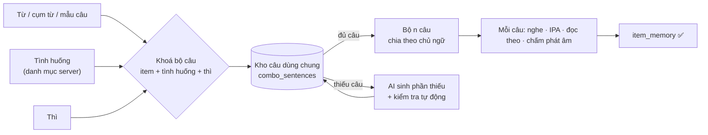
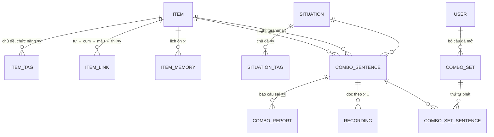
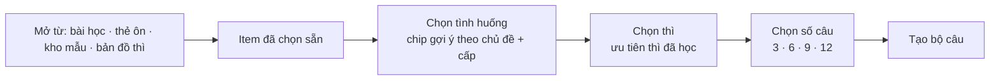
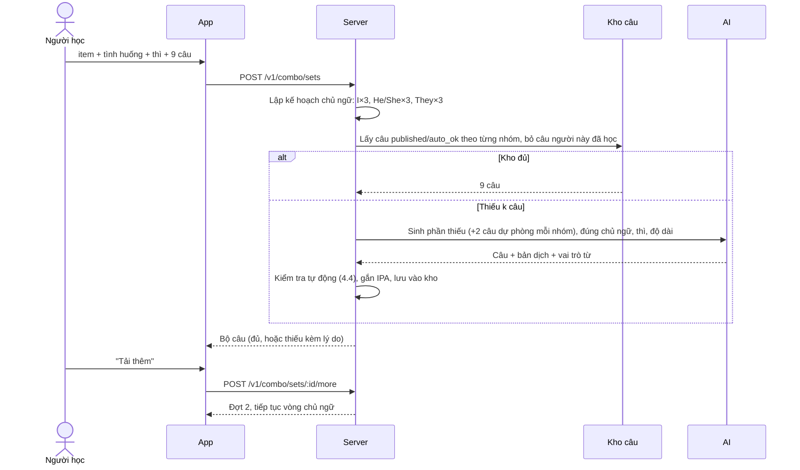
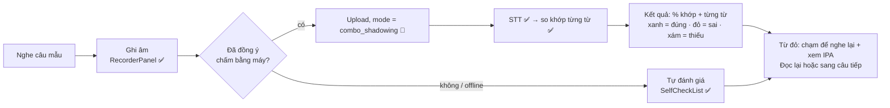

# Thiết kế: Lộ trình Từ · Mẫu câu · Thì

> Trạng thái: **💭 đề xuất, chờ duyệt**. Chưa có code.
> Cập nhật: 2026-10-11 (bản 2: làm lại **câu tổ hợp** theo yêu cầu mới).
> Đối chiếu với [`architecture/lesson-design.md`](../architecture/lesson-design.md) và schema server
> (`items`, `item_memory`, `situations`, `recordings`, `admin_settings`).
> Nguồn nội dung: **Oxford 3000** (A1–B2) và bảng **mẫu câu IELTS Writing**.
> Sơ đồ trực quan: artifact "Lộ trình Từ · Mẫu · Thì".

Ký hiệu: ✅ đã có, dùng lại · 🔧 có rồi, cần mở rộng · 🆕 làm mới

---

## 1. Ý tưởng chính

Người học thường học từ, mẫu câu và thì như 3 danh sách rời. Thiết kế này nối chúng lại bằng **bộ câu tổ hợp**:

> **Từ / cụm từ / mẫu câu** + **tình huống** (chọn từ danh mục) + **thì**
> → server trả về **n câu** dùng đủ cả ba, chia đều theo **chủ ngữ** (I, he/she, they…).
> Mỗi câu có **audio, IPA từng từ, nghe – đọc theo – chấm phát âm**.



**Nguyên tắc: dùng lại tối đa những gì đã có.**

| Cần | Đã có trong LingoBites |
|---|---|
| Danh mục từ, cụm từ, mẫu câu | `items` (`word / phrase / pattern`) ✅ |
| Mẫu câu có slot, slot trỏ tới từ | `pattern` + `payload.slots[].item_refs` ✅ |
| Danh mục tình huống do admin soạn | `situations` (code, tên VI/EN, cấp, đối tượng, sở thích) ✅ |
| IPA theo từ | `lessonText/service/ipa` (cmudict + LLM dự phòng) ✅ |
| Đọc câu | `ttsService` trên máy (en-US, chỉnh tốc độ) ✅ |
| Đọc theo | Shadowing: `SentenceCard`, `RecorderPanel`, `SelfCheckList` ✅ |
| Chấm nói | Upload → STT (OpenAI) → so khớp từng từ (`wordMatch`) ✅ |
| Kiểm duyệt chữ AI sinh | `moderateText` ✅ |
| Cấu hình admin | `admin_settings` (key → JSON) ✅ |
| Lịch ôn theo người học | `item_memory` ✅ |
| Khoá → cấp → unit → bài, bài 6 bước | curriculum + `LessonFlowPlayer` ✅ |

---

## 2. Phân tích yêu cầu câu tổ hợp

### 2.1 Yêu cầu và cách hiểu

| # | Yêu cầu | Cách hiểu trong thiết kế |
|---|---|---|
| R1 | Server **tự sinh** hoặc **lấy câu có sẵn** | Có một kho câu dùng chung cho mọi người học. Khi được yêu cầu, server lấy câu từ kho trước, chỉ gọi AI cho phần còn thiếu. Câu sinh ra được lưu lại cho người sau. |
| R2 | **Số lượng và quy định theo chủ ngữ**, ví dụ 3 câu *I*, 3 câu *they*, 3 câu *he/she* | Một **hạn ngạch chủ ngữ** (subject quota) do admin cấu hình. Mỗi câu gắn 1 nhóm chủ ngữ. Server phát câu theo hạn ngạch. |
| R3 | Đầu vào: **từ / cụm từ / câu + tình huống + thì**. Tình huống **có giới hạn từ server**, người dùng không tự đặt. | Người học chỉ được **chọn** trong `situations` đã publish và phù hợp với item. Không có ô nhập tự do (khác tính năng Khoảnh khắc). |
| R4 | Ra **n câu** tuỳ setting, hoặc người dùng bấm **tải thêm** | `n` mặc định lấy từ admin. Người học được chọn trong các mức cho phép (3 / 6 / 9 / 12). "Tải thêm" lấy đợt tiếp theo, tiếp tục đúng vòng chủ ngữ. |
| R5 | Mỗi câu có **phần đọc + IPA theo từ** | Câu lưu sẵn danh sách từ (token), mỗi token có IPA và vai trò (chủ ngữ / động từ / item). Audio đọc bằng TTS trên máy, có tốc độ chậm. |
| R6 | **Đọc theo + kiểm tra phát âm** | Dùng luồng shadowing có sẵn và thêm chế độ ghi âm `combo_shadowing`. Server chấm theo từng từ. Không có consent thì tự đánh giá. |

### 2.2 Những điểm cần lưu ý khi làm

1. **Đổi chủ ngữ thì động từ đổi theo.** Đây chính là giá trị học: người học thấy rõ *I have placed* / *she has placed*, *I do* / *he does*. Câu nên tô màu phần động từ đã chia.
2. **Không phải mẫu nào cũng hợp mọi chủ ngữ.** Mẫu IELTS trang trọng ("Many schools place a heavy emphasis on…") đi với *I* thì gượng. Vì vậy mỗi item có thể **ghi đè hạn ngạch**: ví dụ mẫu IELTS dùng nhóm chủ ngữ `noun_phrase` (Many schools, The government…) thay cho *I*.
3. **Không phải tình huống nào cũng hợp mọi từ.** Ví dụ "emphasis" khó đi với "Gọi đồ uống". Server chỉ gợi ý các tình huống **trùng chủ đề** với item. Nếu AI báo câu không tự nhiên thì bỏ câu đó, và bộ câu có thể trả **ít câu hơn kèm lý do**.
4. **Số tổ hợp có thể rất lớn**: ~4.500 item × 12 thì × ~50 tình huống × 5 nhóm chủ ngữ. Vì vậy **không sinh trước toàn bộ**. Chỉ sinh trước (prewarm) các tổ hợp nằm trong bài giáo trình. Phần còn lại sinh khi có người yêu cầu và lưu vào kho.
5. **Chấm phát âm hiện tại là chấm theo từ, không theo âm.** STT nghe ra từ nào thì so với câu mẫu. Cách này bắt được từ bị thiếu hoặc nói thành từ khác, nhưng **không** bắt được lỗi âm cuối, trọng âm hay ngữ điệu, và STT còn hay tự "sửa" giúp người nói. Muốn chấm theo âm vị cần một dịch vụ chấm phát âm riêng: **dependency mới, có chi phí, cần bạn duyệt** (xem mục 9).

---

## 3. Tổ chức dữ liệu

### 3.1 Mô hình tổng thể



### 3.2 Bảng `items` 🔧

| Thay đổi | Kiểu | Ý nghĩa |
|---|---|---|
| `cefr_level` 🆕 | `varchar(4)` null | `A1`…`C1`, lấy từ Oxford 3000 |
| `frequency_rank` 🆕 | `int` null | Thứ tự ưu tiên trong cùng cấp |
| `kind = 'grammar'` 🆕 | giá trị mới | Thì và điểm ngữ pháp |

Hai cột mới cho phép null, nên **không đụng dữ liệu cũ**.

**Mã item bị khoá sau khi publish.** Oxford 3000 có từ cùng chữ khác nghĩa, nên cần thêm hậu tố nghĩa vào mã: `word:bank-money`, `word:bank-river`, `word:close-verb`, `word:close-adj`. Mẫu câu đặt mã như `pattern:place-emphasis-on`, thì như `grammar:present-perfect`.

**Mẫu câu** dùng khung `{slot}` sẵn có:

```jsonc
{ "kind": "pattern", "code": "pattern:place-emphasis-on",
  "text": "{subject} place a heavy emphasis on {thing}",
  "meaning_vi": "Đặt sự chú trọng lớn vào…", "cefr_level": "B2",
  "payload": { "slots": {
    "subject": { "label_vi": "Ai / tổ chức", "values": ["Many schools", "The government"] },
    "thing":   { "label_vi": "Điều được chú trọng", "item_refs": ["phrase:academic-performance"] } } } }
```

**Thì** (`grammar`) 🆕:

```jsonc
{ "kind": "grammar", "code": "grammar:present-perfect",
  "text": "Present perfect", "meaning_vi": "Hiện tại hoàn thành", "cefr_level": "A2",
  "payload": {
    "family": "tense", "time": "present", "aspect": "perfect",
    "forms": { "affirmative": "{subject} have/has + V3",
               "negative": "{subject} have/has not + V3",
               "question": "Have/Has + {subject} + V3?" },
    "signals": ["since", "for", "already", "yet", "over the past …"],
    "contrast_with": ["grammar:past-simple"],
    "check": { "aux": ["have", "has", "'ve", "'s"], "verb_form": "past_participle" } } }
```

Trường `check` 🆕 được server dùng để **tự kiểm tra thì** của câu AI sinh (mục 4.4).

### 3.3 Tình huống: dùng bảng `situations` ✅ và thêm nhãn 🔧

Bảng `situations` đã có `code`, `title_vi/en`, `description_en`, `level_code`, `audience`, `status`. Cần thêm:
- `situation_tags` 🆕: gắn chủ đề (`topic:education`…) để gợi ý tình huống hợp với item.
- `register` 🆕 (`casual` / `neutral` / `formal`): tránh ghép mẫu IELTS với tình huống đời thường.

Người học **chỉ chọn**, không tạo mới. Admin soạn tình huống trong `admin-web` như hiện nay.

### 3.4 Kho câu tổ hợp 🆕

```sql
-- Một câu trong kho, dùng chung cho mọi người học
CREATE TABLE combo_sentences (
  id               uuid PRIMARY KEY,
  item_id          uuid NOT NULL REFERENCES items,      -- từ / cụm từ / mẫu
  grammar_item_id  uuid NOT NULL REFERENCES items,      -- thì
  situation_id     uuid NOT NULL REFERENCES situations,
  subject_group    varchar(16) NOT NULL,  -- i | you | he_she | we | they | noun_phrase
  subject_text     varchar(80)  NOT NULL, -- 'I', 'She', 'Many schools'
  polarity         varchar(12)  NOT NULL DEFAULT 'affirmative', -- affirmative | negative | question
  text_en          varchar(300) NOT NULL,
  text_vi          varchar(400) NOT NULL,
  tokens           jsonb NOT NULL,   -- [{ "t": "has", "ipa": "/hæz/", "role": "aux" }, …]
  level_code       varchar(4)  NOT NULL,
  source           varchar(8)  NOT NULL,   -- admin | ai
  status           varchar(12) NOT NULL,   -- draft | auto_ok | published | flagged | archived
  checks           jsonb NOT NULL DEFAULT '{}', -- kết quả kiểm tra tự động
  prompt_version   varchar(32),
  created_at       timestamptz NOT NULL DEFAULT now()
);
CREATE UNIQUE INDEX ON combo_sentences (item_id, grammar_item_id, situation_id, lower(text_en));
CREATE INDEX ON combo_sentences (item_id, grammar_item_id, situation_id, subject_group, status);

-- Bộ câu người học đã mở: để "tải thêm" và học lại
CREATE TABLE combo_sets (
  id               uuid PRIMARY KEY,
  user_id          uuid NOT NULL REFERENCES users ON DELETE CASCADE,
  item_id          uuid NOT NULL REFERENCES items,
  grammar_item_id  uuid NOT NULL REFERENCES items,
  situation_id     uuid NOT NULL REFERENCES situations,
  quota            jsonb NOT NULL,   -- hạn ngạch đã áp, ví dụ {"i":3,"he_she":3,"they":3}
  next_cursor      int  NOT NULL DEFAULT 0,  -- vị trí trong vòng chủ ngữ
  created_at       timestamptz NOT NULL DEFAULT now()
);
CREATE TABLE combo_set_sentences (
  set_id      uuid REFERENCES combo_sets ON DELETE CASCADE,
  sentence_id uuid REFERENCES combo_sentences,
  position    int NOT NULL,
  batch       int NOT NULL,              -- đợt 1, 2 (tải thêm)…
  PRIMARY KEY (set_id, sentence_id)
);

-- Người học báo câu sai / không tự nhiên (giống lesson_item_reports)
CREATE TABLE combo_reports (
  id uuid PRIMARY KEY, sentence_id uuid REFERENCES combo_sentences,
  user_id uuid REFERENCES users ON DELETE SET NULL,
  reason varchar(24) NOT NULL, note varchar(300), created_at timestamptz DEFAULT now()
);
```

Câu bị báo sai ≥ 2 lần thì tự chuyển `flagged`, không phát nữa và vào hàng đợi admin duyệt.

### 3.5 Cấu hình (`admin_settings`) ✅ thêm key

| Key | Mặc định | Ý nghĩa |
|---|---|---|
| `combo.subject_quota` | `{"i":3,"he_she":3,"they":3}` | Hạn ngạch mỗi đợt. `he_she` xen kẽ He / She. |
| `combo.batch_sizes` | `[3, 6, 9, 12]` | Các mức người học được chọn |
| `combo.default_batch` | `9` | Số câu đợt đầu |
| `combo.max_per_set` | `27` | Tối đa sau nhiều lần "tải thêm" |
| `combo.daily_ai_generations` | `5` | Số lần **gọi AI** mỗi ngày cho một người học. Lấy từ kho thì không tính. |
| `combo.pronunciation_pass` | `0.8` | Ngưỡng độ khớp từ để coi là đọc đạt |
| `combo.max_words` | `{"A1":8,"A2":12,"B1":16,"B2":20}` | Độ dài câu tối đa theo cấp |

Item được ghi đè hạn ngạch qua `items.payload.combo_quota`. Ví dụ mẫu IELTS: `{"noun_phrase":3,"they":3,"we":3}`.

### 3.6 Khoá học ✅

```
Khoá "Oxford 3000 + IELTS"
 └─ Cấp A1 · A2 · B1 · B2
     └─ Unit = 1 chủ đề = 1 tuần (education, work, travel…)
         ├─ Bài 1–4: ≈ 12 từ + 1 mẫu + 1 thì + 1–2 tình huống của chủ đề
         └─ Nhiệm vụ tổng hợp: viết / nói đoạn ngắn
```

Mỗi bài khai báo sẵn tình huống và thì, nên bộ câu tổ hợp của bài được **sinh trước** khi publish bài.

---

## 4. Luồng tạo bộ câu tổ hợp

### 4.1 Người học chọn đầu vào



- Vào từ bài học: item, tình huống và thì đã điền sẵn theo bài, người học chỉ bấm "Luyện câu".
- Danh sách tình huống lấy từ `GET /v1/combo/situations?item=…`: `published`, đúng `audience`, cấp ≤ cấp người học + 1, trùng chủ đề và register hợp.
- Thì: các thì người học đã gặp được xếp trước. Thì chưa học có nhãn "Mới".

### 4.2 Server ghép bộ câu



- **Thứ tự phát:** gom theo nhóm chủ ngữ (3 câu *I*, rồi 3 câu *He/She*…) để người học thấy động từ đổi theo chủ ngữ. Có nút xem "trộn" khi ôn.
- **Tải thêm:** mỗi đợt lấy lại đúng hạn ngạch, không lặp câu đã phát trong bộ, dừng ở `combo.max_per_set`.
- **Hết lượt AI trong ngày:** chỉ phát câu đang có trong kho. Nếu kho không đủ, trả số câu có được và báo "Hôm nay đã hết lượt tạo câu mới".
- **Tài khoản trẻ em:** chỉ nhận câu `published` (đã được admin duyệt), không gọi AI.
- **Offline:** bộ câu đã mở được tải về máy, học lại được. Chưa từng tải thì không tạo được.

### 4.3 Prompt sinh câu (tóm tắt)

AI nhận: item (chữ, nghĩa, khung slot), tình huống (`description_en`, register), thì (`forms`, `signals`), danh sách chủ ngữ cần sinh, cấp, độ dài tối đa. AI trả JSON, mỗi câu gồm `subject_group`, `subject_text`, `text_en`, `text_vi`, vai trò của từng token (`subject` / `aux` / `verb` / `item` / `other`) và cờ `natural: true/false`.

Nội dung tình huống được nhúng như dữ liệu trong prompt, giống cách đang chống prompt injection cho Khoảnh khắc. Prompt quản lý trong `ai_prompts` ✅ với key mới `combo.generate`.

### 4.4 Kiểm tra tự động trước khi vào kho

| Kiểm tra | Cách làm | Sai thì |
|---|---|---|
| Có item | So token với chữ của item và các dạng biến đổi (`-s`, `-ed`, `-ing`, V3). Với mẫu câu thì khớp khung. | Bỏ câu |
| Đúng chủ ngữ | Token `role = subject` khớp `subject_group` | Bỏ câu |
| Đúng thì | Trợ động từ và dạng động từ khớp `grammar.payload.check` | Bỏ câu |
| Hoà hợp chủ–động từ | Luật cho he/she/it + hiện tại đơn (`-s`, `has`, `does`) | Bỏ câu |
| Độ dài, cấp từ | ≤ `combo.max_words`; từ ngoài Oxford 3000 hoặc trên cấp + 1 ≤ 2 từ | Bỏ câu |
| An toàn | `moderateText` ✅ | Bỏ câu, ghi log |
| IPA | cmudict cho từng token, thiếu thì dùng LLM như hiện nay ✅ | Thiếu IPA vẫn giữ câu, token đó hiện "—" |
| Tự nhiên | `natural = false` do AI tự báo | Bỏ câu |

Đạt hết thì câu nhận trạng thái `auto_ok` và được phát ngay. Admin duyệt thì chuyển `published`.

---

## 5. Học một câu: nghe · IPA · đọc theo · chấm

### 5.1 Thẻ câu

```
┌───────────────────────────────────────────────┐
│ ● She  ·  Hiện tại hoàn thành  ·  Ở trường     │
│                                               │
│ She has placed a heavy emphasis on her exams. │
│ /ʃi/ /hæz/ /pleɪst/ /ə/ /ˈhevi/ /ˈemfəsɪs/ …   │  ← IPA dưới từng từ (bật/tắt)
│ Cô ấy đã rất chú trọng vào các kỳ thi.         │
│                                               │
│  ▶ Nghe   🐢 Chậm   🎙 Đọc theo   ⚑ Báo sai     │
└───────────────────────────────────────────────┘
```

- **Tô màu theo vai trò:** item chính, trợ động từ + động từ (phần thể hiện thì), chủ ngữ.
- **Chạm vào một từ:** hiện IPA, nghĩa và nghe riêng từ đó. Nếu từ là item trong kho thì có nút "Thêm vào ôn".
- **Nghe:** TTS trên máy ✅, tốc độ thường và chậm (`DEFAULT_TTS_RATE`). Để sau: server tạo audio sẵn cho câu `published` để giọng đọc đồng nhất.

### 5.2 Đọc theo và chấm phát âm



- Chế độ ghi âm mới `combo_shadowing` tham chiếu `combo_sentence_id`. Áp các luật hiện có: ghi âm ≤ 35 giây, file xoá sau 30 ngày, chữ nhận dạng không lưu.
- **Đạt** khi độ khớp từ ≥ `combo.pronunciation_pass`. Đọc lại thoải mái; lượt cao nhất được giữ.
- Gợi ý STT (hints) gồm câu mẫu và từ của item, giống `sttHints` đang dùng cho bước 5.
- `not_assessable` (lỗi âm thanh, lỗi server) **không tính là sai**.
- **Giới hạn:** chấm theo từ chỉ cho biết người nghe có hiểu được không. Không chấm được âm cuối, trọng âm hay ngữ điệu (xem 2.2 và mục 9).

### 5.3 Kết thúc bộ câu

Màn tổng kết hiện: số câu đã đọc đạt, các từ hay đọc sai (gộp theo từ), và so sánh động từ theo chủ ngữ (*I have placed* ↔ *she has placed*). Có 3 nút: "Tải thêm", "Đổi tình huống", "Đổi thì".

---

## 6. Tính năng

| # | Tính năng | Người học thấy gì | Dựa trên |
|---|---|---|---|
| **F1** | Lộ trình từ vựng | A1→B2 chia theo chủ đề, gói ≈ 12 từ, kiểm tra nhanh "đã biết" | `cefr_level`, tags, `item_memory` |
| **F2** | Kho mẫu câu theo chức năng | Tra theo ý muốn nói (nhấn mạnh, nguyên nhân…). Mỗi mẫu có nút "Luyện câu tổ hợp". | `pattern` + tag `function:*` |
| **F3** | Bản đồ thì 3 × 4 | Lưới thời gian × khía cạnh, tô màu theo mức nhớ. Chạm vào ô để xem công thức, dấu hiệu, thì hay nhầm, và nút "Luyện câu". | `grammar` |
| **F4** | Bài tuần chủ đề | Bài 6 bước. Bước 2–4 dùng bộ câu tổ hợp của bài. | `LessonFlowPlayer` ✅ |
| **F5** | **Bộ câu tổ hợp** | Chọn item + tình huống + thì + số câu. Server trả câu chia theo chủ ngữ. Có "Tải thêm". | Mục 3.4, 4 |
| **F6** | **Đọc theo + chấm phát âm** | Mỗi câu: nghe, IPA từng từ, ghi âm, kết quả từng từ | Shadowing ✅, STT ✅, mục 5 |
| **F7** | Ôn theo thang | Hàng ôn trộn 3 loại, dạng bài khó dần | `item_memory` ✅ |
| **F8** | Viết / nói đoạn cuối tuần | Bắt buộc dùng đủ số từ, mẫu và thì của tuần | `tasks` ✅ |
| **F9** | Bảng tiến độ | Đã nhớ x / 3.000 từ, lưới thì, tỷ lệ đọc đạt | `item_memory.stable_at` ✅ |

**Màn mới hoặc đổi:**

| Màn | Loại | Ghi chú |
|---|---|---|
| `WordPathScreen`, `QuickKnownCheck` | 🆕 | F1 |
| `PatternLibraryScreen`, `TenseMapScreen` | 🆕 | F2, F3 |
| `ComboSetupSheet` | 🆕 | Chọn tình huống, thì, số câu |
| `ComboSetScreen` | 🆕 | Danh sách thẻ câu theo nhóm chủ ngữ, nút "Tải thêm" |
| `ComboShadowingScreen` | 🔧 | Dùng lại `ShadowingSessionScreen`, thêm IPA và kết quả từng từ |
| `ItemReviewScreen` | 🔧 | Thêm dạng bài bậc 3 (mục 7) |

**API mới:**

| Method | Path | Ghi chú |
|---|---|---|
| GET | `/v1/combo/situations?item=` | Tình huống phù hợp |
| POST | `/v1/combo/sets` | `{item_code, grammar_code, situation_code, count}` |
| POST | `/v1/combo/sets/:id/more` | Đợt tiếp theo |
| GET | `/v1/combo/sets/:id` | Học lại / tải về offline |
| POST | `/v1/combo/sentences/:id/reports` | Báo câu sai |
| POST | `/v1/recordings` 🔧 | Thêm `mode = combo_shadowing` |

---

## 7. Ôn luyện

Giữ lịch ôn `1 · 3 · 7 · 14 · 30 · 60 · 120` ngày ✅ và luật **chỉ lượt `kind = review` mới dời lịch**. Luyện bộ câu tự do là `practice`, không làm lệch lịch.

Dạng bài thay đổi theo `item_memory.stage`, không cần thêm cột:

| Bậc | Từ / cụm từ | Mẫu câu | Thì | Chấm |
|---|---|---|---|---|
| **1 · Nhận ra** (1–3 ngày) | Nghe / đọc → chọn nghĩa | Chọn câu đúng khung | Nhìn câu → chọn tên thì | App, offline |
| **2 · Nhớ lại** (7–14 ngày) | Nghĩa VI → gõ từ; điền chỗ trống | Điền phần thiếu của khung | Chia động từ theo chủ ngữ cho sẵn | App, offline |
| **3 · Vận dụng** (30+ ngày) | **Nghe câu tổ hợp → đọc theo** | **Nhìn câu VI → nói câu EN** (câu lấy từ kho) | **Đổi chủ ngữ:** "I have placed…" → nói với *She* | Server chấm theo từ, hoặc tự đánh giá |

Câu cho bậc 3 lấy từ kho `combo_sentences` (những bộ người học đã mở), nên **không tốn thêm lượt AI**.

**Hàng ôn mỗi ngày:**
- Tối đa 20 thẻ (`DAILY_ITEM_REVIEW_LIMIT`).
- Tỷ lệ ~60% từ · ~25% mẫu · ~15% thì.
- Không để quá 2 thẻ cùng loại liền nhau.
- Item sai ≥ 4 lần: hiện thẻ so sánh hoặc lỗi hay gặp trước khi hỏi.
- Sai thì về ôn sau 1 ngày (luật hiện có).

---

## 8. Nạp nội dung và chia giai đoạn

**Nạp nội dung:**
1. Oxford 3000 → CSV → `yarn seed:oxford` 🆕 → item `draft`.
2. AI soạn nghĩa, IPA, ví dụ, chủ đề.
3. Admin duyệt theo lô.
4. Mẫu IELTS và 12 thì do admin nhập.
5. Tình huống: bổ sung nhãn chủ đề và `register` cho danh mục hiện có, thêm tình huống cho B1–B2.

**Giai đoạn:**

| GĐ | Nội dung | Repo | Rủi ro |
|---|---|---|---|
| **P0** | Migration: cột `items`, `kind = grammar`, `tags`, `item_tags`, `item_links`, `situation_tags`, `situations.register` | Server, admin | ⚠️ Migration (chỉ thêm) |
| **P1** | Nạp Oxford 3000, 12 thì, mẫu IELTS; admin duyệt | Server, admin | Khối lượng duyệt lớn |
| **P2** | F1 lộ trình từ + ôn bậc 1–2 | App | Thấp |
| **P3** | **Kho câu tổ hợp:** bảng `combo_*`, API, sinh + kiểm tra tự động, hạn ngạch chủ ngữ, tải thêm, admin duyệt/báo sai | Server, admin | ⚠️ Chi phí AI, chất lượng câu |
| **P4** | **App bộ câu + đọc theo:** `ComboSetScreen`, IPA từng từ, `combo_shadowing`, kết quả từng từ | App, Server | Chấm nói chưa test máy thật |
| **P5** | F2 kho mẫu, F3 bản đồ thì, ôn bậc 3, F8, F9 | App | Thấp |
| **P6** (tuỳ chọn) | Chấm phát âm theo âm vị | Server | ⚠️ Dependency + chi phí mới |

---

## 9. Cần chốt trước khi làm

1. **Hạn ngạch chủ ngữ mặc định:** `I×3, He/She×3, They×3` đã đủ chưa? Có cần thêm *you*, *we*, và câu **phủ định / câu hỏi** (cột `polarity` đã chừa sẵn) không?
2. **Ai duyệt câu AI sinh?** Đề xuất: câu `auto_ok` phát ngay cho người lớn, trẻ em chỉ nhận câu `published`. Có cần admin duyệt hết trước khi phát không?
3. **Hạn mức AI mỗi ngày** (đề xuất 5 lần gọi AI / người / ngày, lấy từ kho thì không tính) và độ dài tối đa của bộ (27 câu)?
4. **Chấm phát âm:** dùng chấm theo từ hiện có (không tốn thêm), hay đầu tư dịch vụ chấm theo âm vị? Ví dụ Azure Speech Pronunciation Assessment hoặc SpeechAce: là **dependency mới, có chi phí theo phút audio**, cần bạn duyệt.
5. **Audio:** dùng TTS trên máy (miễn phí, giọng phụ thuộc máy), hay server tạo audio sẵn cho câu `published`?
6. **Bản quyền Oxford 3000** khi dùng trong app thương mại. Phương án dự phòng: NGSL hoặc CEFR-J.
7. **Bắt đầu từ cấp nào?** Đề xuất A2–B1, vì 42 bài hiện có đã phủ A1–A2.
