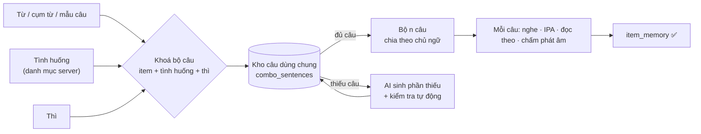
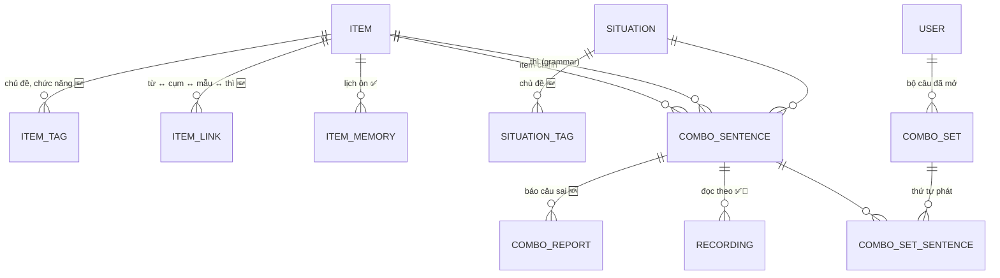
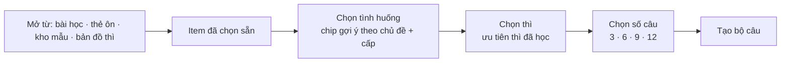
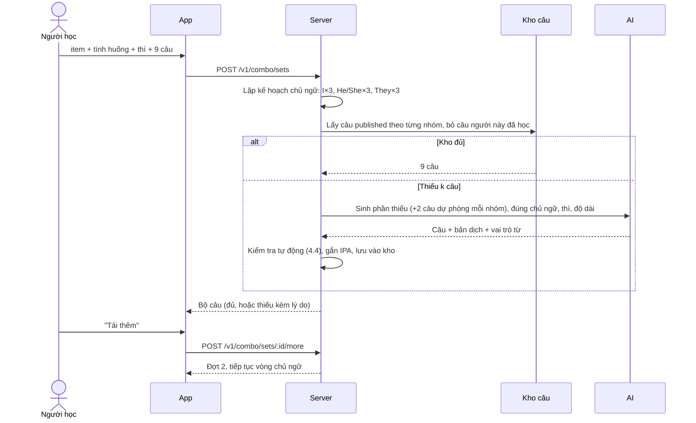
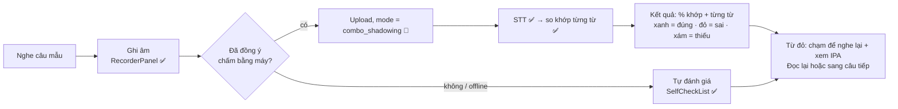
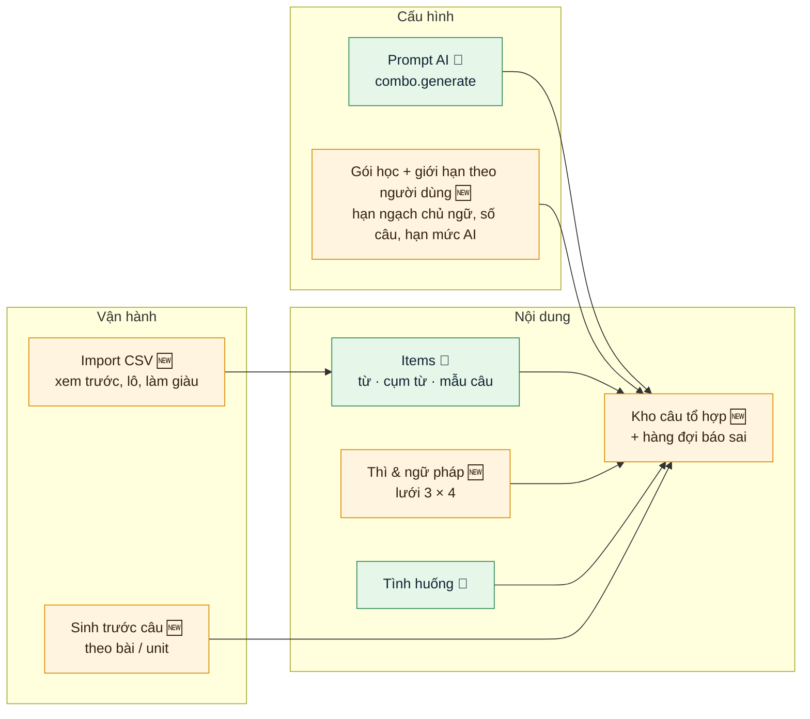
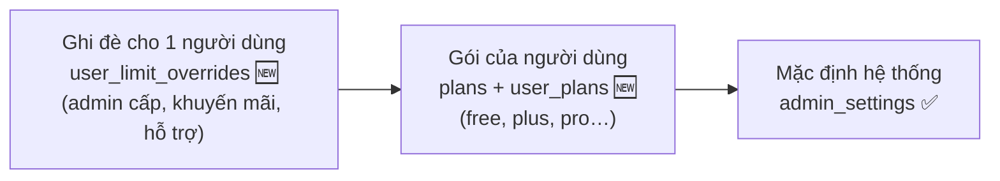
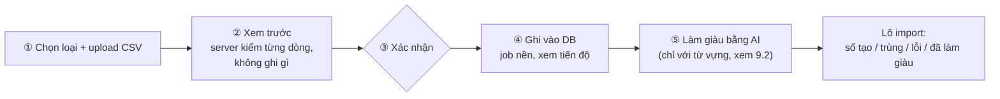

# Thiết kế: Lộ trình Từ · Mẫu câu · Thì

> Trạng thái: **💭 đề xuất, chờ duyệt**. Chưa có code.
> Cập nhật: 2026-10-11 (bản 4: import CSV trên admin, giới hạn theo người dùng, không duyệt tay câu AI, chấm phát âm dời về giai đoạn cuối, kèm dữ liệu Oxford 3000/5000 và 25 mẫu câu).
> Đối chiếu với [`architecture/lesson-design.md`](../architecture/lesson-design.md) và schema server
> (`items`, `item_memory`, `situations`, `recordings`, `admin_settings`).
> Nguồn nội dung: **Oxford 3000** (A1–B2) và bảng **mẫu câu IELTS Writing**.
> Sơ đồ trực quan: artifact "Lộ trình Từ · Mẫu · Thì".

Ký hiệu: ✅ đã có, dùng lại · 🔧 có rồi, cần mở rộng · 🆕 làm mới

---

## 1. Ý tưởng chính

Người học thường học từ, mẫu câu và thì như 3 danh sách rời. Thiết kế này nối chúng lại bằng **bộ câu tổ hợp**:

> **Từ / cụm từ / mẫu câu** + **tình huống** (chọn từ danh mục) + **thì**
> → server trả về **n câu** dùng đủ cả ba, chia đều theo **chủ ngữ** (I, he/she, they…).
> Mỗi câu có **audio, IPA từng từ, nghe – đọc theo – chấm phát âm**.



**Nguyên tắc: dùng lại tối đa những gì đã có.**

| Cần | Đã có trong LingoBites |
|---|---|
| Danh mục từ, cụm từ, mẫu câu | `items` (`word / phrase / pattern`) ✅ |
| Mẫu câu có slot, slot trỏ tới từ | `pattern` + `payload.slots[].item_refs` ✅ |
| Danh mục tình huống do admin soạn | `situations` (code, tên VI/EN, cấp, đối tượng, sở thích) ✅ |
| IPA theo từ | `lessonText/service/ipa` (cmudict + LLM dự phòng) ✅ |
| Đọc câu | `ttsService` trên máy (en-US, chỉnh tốc độ) ✅ |
| Đọc theo | Shadowing: `SentenceCard`, `RecorderPanel`, `SelfCheckList` ✅ |
| Chấm nói | Upload → STT (OpenAI) → so khớp từng từ (`wordMatch`) ✅ |
| Kiểm duyệt chữ AI sinh | `moderateText` ✅ |
| Cấu hình admin | `admin_settings` (key → JSON) ✅ |
| Lịch ôn theo người học | `item_memory` ✅ |
| Khoá → cấp → unit → bài, bài 6 bước | curriculum + `LessonFlowPlayer` ✅ |

---

## 2. Phân tích yêu cầu câu tổ hợp

### 2.1 Yêu cầu và cách hiểu

| # | Yêu cầu | Cách hiểu trong thiết kế |
|---|---|---|
| R1 | Server **tự sinh** hoặc **lấy câu có sẵn** | Có một kho câu dùng chung cho mọi người học. Khi được yêu cầu, server lấy câu từ kho trước, chỉ gọi AI cho phần còn thiếu. Câu sinh ra được lưu lại cho người sau. |
| R2 | **Số lượng và quy định theo chủ ngữ**, ví dụ 3 câu *I*, 3 câu *they*, 3 câu *he/she* | Một **hạn ngạch chủ ngữ** (subject quota) do admin cấu hình. Mỗi câu gắn 1 nhóm chủ ngữ. Server phát câu theo hạn ngạch. |
| R3 | Đầu vào: **từ / cụm từ / câu + tình huống + thì**. Tình huống **có giới hạn từ server**, người dùng không tự đặt. | Người học chỉ được **chọn** trong `situations` đã publish và phù hợp với item. Không có ô nhập tự do (khác tính năng Khoảnh khắc). |
| R4 | Ra **n câu** tuỳ setting, hoặc người dùng bấm **tải thêm** | `n` mặc định lấy từ admin. Người học được chọn trong các mức cho phép (3 / 6 / 9 / 12). "Tải thêm" lấy đợt tiếp theo, tiếp tục đúng vòng chủ ngữ. |
| R5 | Mỗi câu có **phần đọc + IPA theo từ** | Câu lưu sẵn danh sách từ (token), mỗi token có IPA và vai trò (chủ ngữ / động từ / item). Audio đọc bằng TTS trên máy, có tốc độ chậm. |
| R6 | **Đọc theo + kiểm tra phát âm** | ⏳ **Giai đoạn cuối (P7), thiết kế sau**, cùng với nguồn audio. Mục 5.2 chỉ ghi lại hạ tầng đang có để tham khảo. |

### 2.2 Những điểm cần lưu ý khi làm

1. **Đổi chủ ngữ thì động từ đổi theo.** Đây chính là giá trị học: người học thấy rõ *I have placed* / *she has placed*, *I do* / *he does*. Câu nên tô màu phần động từ đã chia.
2. **Không phải mẫu nào cũng hợp mọi chủ ngữ.** Mẫu IELTS trang trọng ("Many schools place a heavy emphasis on…") đi với *I* thì gượng. Vì vậy mỗi item có thể **ghi đè hạn ngạch**: ví dụ mẫu IELTS dùng nhóm chủ ngữ `noun_phrase` (Many schools, The government…) thay cho *I*.
3. **Không phải tình huống nào cũng hợp mọi từ.** Ví dụ "emphasis" khó đi với "Gọi đồ uống". Server chỉ gợi ý các tình huống **trùng chủ đề** với item. Nếu AI báo câu không tự nhiên thì bỏ câu đó, và bộ câu có thể trả **ít câu hơn kèm lý do**.
4. **Số tổ hợp có thể rất lớn**: ~4.500 item × 12 thì × ~50 tình huống × 5 nhóm chủ ngữ. Vì vậy **không sinh trước toàn bộ**. Chỉ sinh trước (prewarm) các tổ hợp nằm trong bài giáo trình. Phần còn lại sinh khi có người yêu cầu và lưu vào kho.
5. **Chấm phát âm hiện tại là chấm theo từ, không theo âm.** STT nghe ra từ nào thì so với câu mẫu. Cách này bắt được từ bị thiếu hoặc nói thành từ khác, nhưng **không** bắt được lỗi âm cuối, trọng âm hay ngữ điệu, và STT còn hay tự "sửa" giúp người nói. Muốn chấm theo âm vị cần một dịch vụ chấm phát âm riêng. Việc này **để giai đoạn cuối** (P7).

---

## 3. Tổ chức dữ liệu

### 3.1 Mô hình tổng thể



### 3.2 Bảng `items` 🔧

| Thay đổi | Kiểu | Ý nghĩa |
|---|---|---|
| `cefr_level` 🆕 | `varchar(4)` null | `A1`…`C1`, lấy từ Oxford 3000 |
| `frequency_rank` 🆕 | `int` null | Thứ tự ưu tiên trong cùng cấp |
| `kind = 'grammar'` 🆕 | giá trị mới | Thì và điểm ngữ pháp |

Hai cột mới cho phép null, nên **không đụng dữ liệu cũ**.

**Mã item bị khoá sau khi publish.** Oxford 3000 có từ cùng chữ khác nghĩa, nên cần thêm hậu tố nghĩa vào mã: `word:bank-money`, `word:bank-river`, `word:close-verb`, `word:close-adj`. Mẫu câu đặt mã như `pattern:place-emphasis-on`, thì như `grammar:present-perfect`.

**Mẫu câu** dùng khung `{slot}` sẵn có:

```jsonc
{ "kind": "pattern", "code": "pattern:place-emphasis-on",
  "text": "{subject} place a heavy emphasis on {thing}",
  "meaning_vi": "Đặt sự chú trọng lớn vào…", "cefr_level": "B2",
  "payload": { "slots": {
    "subject": { "label_vi": "Ai / tổ chức", "values": ["Many schools", "The government"] },
    "thing":   { "label_vi": "Điều được chú trọng", "item_refs": ["phrase:academic-performance"] } } } }
```

**Thì** (`grammar`) 🆕:

```jsonc
{ "kind": "grammar", "code": "grammar:present-perfect",
  "text": "Present perfect", "meaning_vi": "Hiện tại hoàn thành", "cefr_level": "A2",
  "payload": {
    "family": "tense", "time": "present", "aspect": "perfect",
    "forms": { "affirmative": "{subject} have/has + V3",
               "negative": "{subject} have/has not + V3",
               "question": "Have/Has + {subject} + V3?" },
    "signals": ["since", "for", "already", "yet", "over the past …"],
    "contrast_with": ["grammar:past-simple"],
    "check": { "aux": ["have", "has", "'ve", "'s"], "verb_form": "past_participle" } } }
```

Trường `check` 🆕 được server dùng để **tự kiểm tra thì** của câu AI sinh (mục 4.4).

### 3.3 Tình huống: dùng bảng `situations` ✅ và thêm nhãn 🔧

Bảng `situations` đã có `code`, `title_vi/en`, `description_en`, `level_code`, `audience`, `status`. Cần thêm:
- `situation_tags` 🆕: gắn chủ đề (`topic:education`…) để gợi ý tình huống hợp với item.
- `register` 🆕 (`casual` / `neutral` / `formal`): tránh ghép mẫu IELTS với tình huống đời thường.

Người học **chỉ chọn**, không tạo mới. Admin soạn tình huống trong `admin-web` như hiện nay.

### 3.4 Kho câu tổ hợp 🆕

```sql
-- Một câu trong kho, dùng chung cho mọi người học
CREATE TABLE combo_sentences (
  id               uuid PRIMARY KEY,
  item_id          uuid NOT NULL REFERENCES items,      -- từ / cụm từ / mẫu
  grammar_item_id  uuid NOT NULL REFERENCES items,      -- thì
  situation_id     uuid NOT NULL REFERENCES situations,
  subject_group    varchar(16) NOT NULL,  -- i | you | he_she | we | they | noun_phrase
  subject_text     varchar(80)  NOT NULL, -- 'I', 'She', 'Many schools'
  polarity         varchar(12)  NOT NULL DEFAULT 'affirmative', -- affirmative | negative | question
  text_en          varchar(300) NOT NULL,
  text_vi          varchar(400) NOT NULL,
  tokens           jsonb NOT NULL,   -- [{ "t": "has", "ipa": "/hæz/", "role": "aux" }, …]
  level_code       varchar(4)  NOT NULL,
  source           varchar(8)  NOT NULL,   -- admin | ai
  status           varchar(12) NOT NULL,   -- published | flagged | archived (không có bước duyệt tay)
  checks           jsonb NOT NULL DEFAULT '{}', -- kết quả kiểm tra tự động
  prompt_version   varchar(32),
  created_at       timestamptz NOT NULL DEFAULT now()
);
CREATE UNIQUE INDEX ON combo_sentences (item_id, grammar_item_id, situation_id, lower(text_en));
CREATE INDEX ON combo_sentences (item_id, grammar_item_id, situation_id, subject_group, status);

-- Bộ câu người học đã mở: để "tải thêm" và học lại
CREATE TABLE combo_sets (
  id               uuid PRIMARY KEY,
  user_id          uuid NOT NULL REFERENCES users ON DELETE CASCADE,
  item_id          uuid NOT NULL REFERENCES items,
  grammar_item_id  uuid NOT NULL REFERENCES items,
  situation_id     uuid NOT NULL REFERENCES situations,
  quota            jsonb NOT NULL,   -- hạn ngạch đã áp, ví dụ {"i":3,"he_she":3,"they":3}
  next_cursor      int  NOT NULL DEFAULT 0,  -- vị trí trong vòng chủ ngữ
  created_at       timestamptz NOT NULL DEFAULT now()
);
CREATE TABLE combo_set_sentences (
  set_id      uuid REFERENCES combo_sets ON DELETE CASCADE,
  sentence_id uuid REFERENCES combo_sentences,
  position    int NOT NULL,
  batch       int NOT NULL,              -- đợt 1, 2 (tải thêm)…
  PRIMARY KEY (set_id, sentence_id)
);

-- Người học báo câu sai / không tự nhiên (giống lesson_item_reports)
CREATE TABLE combo_reports (
  id uuid PRIMARY KEY, sentence_id uuid REFERENCES combo_sentences,
  user_id uuid REFERENCES users ON DELETE SET NULL,
  reason varchar(24) NOT NULL, note varchar(300), created_at timestamptz DEFAULT now()
);
```

Câu bị báo sai ≥ `combo.report_flag_threshold` lần (mặc định 2) thì tự chuyển `flagged`, không phát nữa và vào hàng đợi báo sai của admin.

### 3.5 Cấu hình: mặc định hệ thống + giới hạn theo người dùng

Bảng dưới là **mặc định hệ thống** (`admin_settings` ✅). Các key về số lượng và hạn mức được **gói học của từng người dùng ghi đè**, xem mục 8.5.

| Key | Mặc định | Ý nghĩa |
|---|---|---|
| `combo.subject_quota` | `{"i":3,"he_she":3,"they":3}` | Hạn ngạch mỗi đợt. `he_she` xen kẽ He / She. |
| `combo.batch_sizes` | `[3, 6, 9, 12]` | Các mức người học được chọn |
| `combo.default_batch` | `9` | Số câu đợt đầu |
| `combo.max_per_set` | `27` | Tối đa sau nhiều lần "tải thêm" |
| `combo.daily_ai_generations` | `5` | Số lần **gọi AI** mỗi ngày cho một người học. Lấy từ kho thì không tính. |
| `combo.max_words` | `{"A1":8,"A2":12,"B1":16,"B2":20}` | Độ dài câu tối đa theo cấp |

Mẫu câu có thể **giới hạn nhóm chủ ngữ phù hợp** qua `items.payload.combo_quota` (ví dụ `be accompanied by` chỉ hợp chủ ngữ là sự việc: `noun_phrase`). Đây là luật ngôn ngữ, áp sau giới hạn của gói.

### 3.6 Khoá học ✅

```
Khoá "Oxford 3000 + IELTS"
 └─ Cấp A1 · A2 · B1 · B2
     └─ Unit = 1 chủ đề = 1 tuần (education, work, travel…)
         ├─ Bài 1–4: ≈ 12 từ + 1 mẫu + 1 thì + 1–2 tình huống của chủ đề
         └─ Nhiệm vụ tổng hợp: viết / nói đoạn ngắn
```

Mỗi bài khai báo sẵn tình huống và thì, nên bộ câu tổ hợp của bài được **sinh trước** khi publish bài.

---

## 4. Luồng tạo bộ câu tổ hợp

### 4.1 Người học chọn đầu vào



- Vào từ bài học: item, tình huống và thì đã điền sẵn theo bài, người học chỉ bấm "Luyện câu".
- Danh sách tình huống lấy từ `GET /v1/combo/situations?item=…`: `published`, đúng `audience`, cấp ≤ cấp người học + 1, trùng chủ đề và register hợp.
- Thì: các thì người học đã gặp được xếp trước. Thì chưa học có nhãn "Mới".

### 4.2 Server ghép bộ câu



- **Thứ tự phát:** gom theo nhóm chủ ngữ (3 câu *I*, rồi 3 câu *He/She*…) để người học thấy động từ đổi theo chủ ngữ. Có nút xem "trộn" khi ôn.
- **Tải thêm:** mỗi đợt lấy lại đúng hạn ngạch, không lặp câu đã phát trong bộ, dừng ở `combo.max_per_set`.
- **Hết lượt AI trong ngày:** chỉ phát câu đang có trong kho. Nếu kho không đủ, trả số câu có được và báo "Hôm nay đã hết lượt tạo câu mới".
- **Hạn ngạch, số câu, số lần gọi AI** lấy từ giới hạn hiệu lực của người dùng (`resolveLimits`, mục 8.5).
- **Offline:** bộ câu đã mở được tải về máy, học lại được. Chưa từng tải thì không tạo được.

### 4.3 Prompt sinh câu (tóm tắt)

AI nhận: item (chữ, nghĩa, khung slot), tình huống (`description_en`, register), thì (`forms`, `signals`), danh sách chủ ngữ cần sinh, cấp, độ dài tối đa. AI trả JSON, mỗi câu gồm `subject_group`, `subject_text`, `text_en`, `text_vi`, vai trò của từng token (`subject` / `aux` / `verb` / `item` / `other`) và cờ `natural: true/false`.

Nội dung tình huống được nhúng như dữ liệu trong prompt, giống cách đang chống prompt injection cho Khoảnh khắc. Prompt quản lý trong `ai_prompts` ✅ với key mới `combo.generate`.

### 4.4 Kiểm tra tự động trước khi vào kho

| Kiểm tra | Cách làm | Sai thì |
|---|---|---|
| Có item | So token với chữ của item và các dạng biến đổi (`-s`, `-ed`, `-ing`, V3). Với mẫu câu thì khớp khung. | Bỏ câu |
| Đúng chủ ngữ | Token `role = subject` khớp `subject_group` | Bỏ câu |
| Đúng thì | Trợ động từ và dạng động từ khớp `grammar.payload.check` | Bỏ câu |
| Hoà hợp chủ–động từ | Luật cho he/she/it + hiện tại đơn (`-s`, `has`, `does`) | Bỏ câu |
| Độ dài, cấp từ | ≤ `combo.max_words`; từ ngoài Oxford 3000 hoặc trên cấp + 1 ≤ 2 từ | Bỏ câu |
| An toàn | `moderateText` ✅ | Bỏ câu, ghi log |
| IPA | cmudict cho từng token, thiếu thì dùng LLM như hiện nay ✅ | Thiếu IPA vẫn giữ câu, token đó hiện "—" |
| Tự nhiên | `natural = false` do AI tự báo | Bỏ câu |

Đạt hết thì câu được `published` và phát ngay, không chờ admin. Chất lượng được giữ bằng prompt và case mẫu (mục 8.6).

---

## 5. Học một câu: nghe · IPA · đọc theo · chấm

> 5.1 (chữ, bản dịch, IPA từng từ) làm ở P5. **Nguồn audio, đọc theo và chấm phát âm (5.2) để giai đoạn cuối (P7) và sẽ thiết kế lại.** Phần 5.2 dưới đây chỉ ghi hạ tầng đang có để tham khảo.

### 5.1 Thẻ câu

```
┌───────────────────────────────────────────────┐
│ ● She  ·  Hiện tại hoàn thành  ·  Ở trường     │
│                                               │
│ She has placed a heavy emphasis on her exams. │
│ /ʃi/ /hæz/ /pleɪst/ /ə/ /ˈhevi/ /ˈemfəsɪs/ …   │  ← IPA dưới từng từ (bật/tắt)
│ Cô ấy đã rất chú trọng vào các kỳ thi.         │
│                                               │
│  ▶ Nghe   🐢 Chậm   🎙 Đọc theo   ⚑ Báo sai     │
└───────────────────────────────────────────────┘
```

- **Tô màu theo vai trò:** item chính, trợ động từ + động từ (phần thể hiện thì), chủ ngữ.
- **Chạm vào một từ:** hiện IPA, nghĩa và nghe riêng từ đó. Nếu từ là item trong kho thì có nút "Thêm vào ôn".
- **Nghe:** TTS trên máy ✅, tốc độ thường và chậm (`DEFAULT_TTS_RATE`). Để sau: server tạo audio sẵn cho câu `published` để giọng đọc đồng nhất.

### 5.2 Đọc theo và chấm phát âm



- Chế độ ghi âm mới `combo_shadowing` tham chiếu `combo_sentence_id`. Áp các luật hiện có: ghi âm ≤ 35 giây, file xoá sau 30 ngày, chữ nhận dạng không lưu.
- **Đạt** khi độ khớp từ ≥ `combo.pronunciation_pass`. Đọc lại thoải mái; lượt cao nhất được giữ.
- Gợi ý STT (hints) gồm câu mẫu và từ của item, giống `sttHints` đang dùng cho bước 5.
- `not_assessable` (lỗi âm thanh, lỗi server) **không tính là sai**.
- **Giới hạn:** chấm theo từ chỉ cho biết người nghe có hiểu được không. Không chấm được âm cuối, trọng âm hay ngữ điệu (xem 2.2).

### 5.3 Kết thúc bộ câu

Màn tổng kết hiện: số câu đã đọc đạt, các từ hay đọc sai (gộp theo từ), và so sánh động từ theo chủ ngữ (*I have placed* ↔ *she has placed*). Có 3 nút: "Tải thêm", "Đổi tình huống", "Đổi thì".

---

## 6. Tính năng

| # | Tính năng | Người học thấy gì | Dựa trên |
|---|---|---|---|
| **F1** | Lộ trình từ vựng | A1→B2 chia theo chủ đề, gói ≈ 12 từ, kiểm tra nhanh "đã biết" | `cefr_level`, tags, `item_memory` |
| **F2** | Kho mẫu câu theo chức năng | Tra theo ý muốn nói (nhấn mạnh, nguyên nhân…). Mỗi mẫu có nút "Luyện câu tổ hợp". | `pattern` + tag `function:*` |
| **F3** | Bản đồ thì 3 × 4 | Lưới thời gian × khía cạnh, tô màu theo mức nhớ. Chạm vào ô để xem công thức, dấu hiệu, thì hay nhầm, và nút "Luyện câu". | `grammar` |
| **F4** | Bài tuần chủ đề | Bài 6 bước. Bước 2–4 dùng bộ câu tổ hợp của bài. | `LessonFlowPlayer` ✅ |
| **F5** | **Bộ câu tổ hợp** | Chọn item + tình huống + thì + số câu. Server trả câu chia theo chủ ngữ. Có "Tải thêm". | Mục 3.4, 4 |
| **F6** | **Đọc theo + chấm phát âm** ⏳ P7 | Thiết kế ở giai đoạn cuối | Mục 5.2 |
| **F7** | Ôn theo thang | Hàng ôn trộn 3 loại, dạng bài khó dần | `item_memory` ✅ |
| **F8** | Viết / nói đoạn cuối tuần | Bắt buộc dùng đủ số từ, mẫu và thì của tuần | `tasks` ✅ |
| **F9** | Bảng tiến độ | Đã nhớ x / 3.000 từ, lưới thì, tỷ lệ đọc đạt | `item_memory.stable_at` ✅ |

**Màn mới hoặc đổi:**

| Màn | Loại | Ghi chú |
|---|---|---|
| `WordPathScreen`, `QuickKnownCheck` | 🆕 | F1 |
| `PatternLibraryScreen`, `TenseMapScreen` | 🆕 | F2, F3 |
| `ComboSetupSheet` | 🆕 | Chọn tình huống, thì, số câu |
| `ComboSetScreen` | 🆕 | Danh sách thẻ câu theo nhóm chủ ngữ, nút "Tải thêm" |
| `ComboShadowingScreen` | ⏳ P7 | Thiết kế ở giai đoạn cuối |
| `ItemReviewScreen` | 🔧 | Thêm dạng bài bậc 3 (mục 7) |

**API mới:**

| Method | Path | Ghi chú |
|---|---|---|
| GET | `/v1/combo/situations?item=` | Tình huống phù hợp |
| POST | `/v1/combo/sets` | `{item_code, grammar_code, situation_code, count}` |
| POST | `/v1/combo/sets/:id/more` | Đợt tiếp theo |
| GET | `/v1/combo/sets/:id` | Học lại / tải về offline |
| POST | `/v1/combo/sentences/:id/reports` | Báo câu sai |
| POST | `/v1/recordings` ⏳ P7 | Thiết kế ở giai đoạn cuối |
| GET | `/v1/me/limits` | Giới hạn hiệu lực và số lượt còn lại (mục 8.5) |

---

## 7. Ôn luyện

Giữ lịch ôn `1 · 3 · 7 · 14 · 30 · 60 · 120` ngày ✅ và luật **chỉ lượt `kind = review` mới dời lịch**. Luyện bộ câu tự do là `practice`, không làm lệch lịch.

Dạng bài thay đổi theo `item_memory.stage`, không cần thêm cột:

| Bậc | Từ / cụm từ | Mẫu câu | Thì | Chấm |
|---|---|---|---|---|
| **1 · Nhận ra** (1–3 ngày) | Nghe / đọc → chọn nghĩa | Chọn câu đúng khung | Nhìn câu → chọn tên thì | App, offline |
| **2 · Nhớ lại** (7–14 ngày) | Nghĩa VI → gõ từ; điền chỗ trống | Điền phần thiếu của khung | Chia động từ theo chủ ngữ cho sẵn | App, offline |
| **3 · Vận dụng** (30+ ngày) | **Nghe câu tổ hợp → đọc theo** | **Nhìn câu VI → nói câu EN** (câu lấy từ kho) | **Đổi chủ ngữ:** "I have placed…" → nói với *She* | Server chấm theo từ, hoặc tự đánh giá |

Câu cho bậc 3 lấy từ kho `combo_sentences` (những bộ người học đã mở), nên **không tốn thêm lượt AI**.

**Trước P7** (chưa có đọc theo / chấm nói), bậc 3 dùng dạng **viết** với câu từ kho, app chấm offline: nhìn câu VI → **sắp xếp từ** thành câu EN; đổi chủ ngữ → **gõ lại động từ** đã chia (*I have placed* → *She ___ placed*). Dạng nói ở bảng trên bật khi P7 xong.

**Hàng ôn mỗi ngày:**
- Tối đa 20 thẻ (`DAILY_ITEM_REVIEW_LIMIT`).
- Tỷ lệ ~60% từ · ~25% mẫu · ~15% thì.
- Không để quá 2 thẻ cùng loại liền nhau.
- Item sai ≥ 4 lần: hiện thẻ so sánh hoặc lỗi hay gặp trước khi hỏi.
- Sai thì về ôn sau 1 ngày (luật hiện có).

---

## 8. Quản trị trên web admin

Mọi nội dung và tham số của tính năng này đều sửa được trên `admin-web`, không cần sửa code. Phần lớn là mở rộng trang đã có.



Mọi thay đổi đều ghi vào `admin_audit_log` ✅, như trang cài đặt chấm bài hiện nay.

### 8.1 Items: từ, cụm từ, mẫu câu 🔧 (`ItemListPage`, `ItemEditPage`)

| Phần | Thêm gì |
|---|---|
| Bộ lọc | Cấp CEFR, nhãn (chủ đề / chức năng / kỳ thi), **danh sách nguồn** (`list:oxford-3000`, `list:oxford-5000`, `list:ielts-patterns`), lô import, "chưa duyệt" |
| Cột | Cấp, nhãn, số câu tổ hợp trong kho, số lần bị báo sai |
| Sửa item | `cefr_level`, `frequency_rank`, nhãn, liên kết (`item_links`: collocation, word family, đồng nghĩa, thì hay nhầm) |
| Mẫu câu | Khung `{slot}` (đã có) + **ghi đè hạn ngạch chủ ngữ** (`payload.combo_quota`) + ví dụ theo từng thì |
| **Thao tác hàng loạt** | Chọn nhiều item → duyệt + publish, gắn / gỡ nhãn, đổi cấp, archive. Cần cho khối lượng hàng nghìn từ. |
| Màn duyệt nhanh | Xem từng item, phím tắt **Duyệt / Sửa / Bỏ qua**, tự sang item tiếp theo trong lô |

### 8.2 Thì và ngữ pháp 🆕 (`GrammarPage`)

- Màn chính là **lưới 3 × 4** (quá khứ / hiện tại / tương lai × đơn / tiếp diễn / hoàn thành / HT tiếp diễn). Chạm vào ô để sửa item `grammar` của ô đó.
- Các trường sửa được: tên VI/EN, cách dùng, công thức (khẳng định / phủ định / câu hỏi), dấu hiệu nhận biết, thì hay nhầm, lỗi hay gặp, cấp CEFR, thứ tự dạy.
- **Luật kiểm tra thì** (`payload.check`): trợ động từ, dạng động từ. Có ô **"Thử câu"**: dán một câu vào, xem server nhận ra thì gì. Dùng để kiểm luật trước khi lưu.
- Ngữ pháp ngoài thì (bị động, câu điều kiện…) thêm sau, dùng cùng màn ở dạng danh sách.

### 8.3 Tình huống 🔧 (`SituationsPage`)

| Đã có | Thêm |
|---|---|
| code, tên VI/EN, mô tả EN, cấp, đối tượng, trạng thái, thứ tự | Nhãn chủ đề, `register` (casual / neutral / formal), **dùng cho câu tổ hợp: bật/tắt**, xem trước item phù hợp, số câu đã có trong kho |

Người học **chỉ thấy** tình huống `published` và có bật "dùng cho câu tổ hợp".

### 8.4 Kho câu tổ hợp 🆕 (`ComboSentencesPage`)

| Phần | Nội dung |
|---|---|
| Bộ lọc | Item, tình huống, thì, nhóm chủ ngữ, trạng thái (`published / flagged / archived`), nguồn (`admin / ai`), phiên bản prompt |
| Bảng | Câu EN + VI, chủ ngữ, kết quả kiểm tra tự động, số lần phát, tỷ lệ đọc đạt, số lần bị báo |
| Thao tác | Sửa câu (server chạy lại kiểm tra + IPA), archive, archive hàng loạt theo phiên bản prompt, **thêm câu thủ công** (`source = admin`). Không có bước duyệt. |
| **Ma trận độ phủ** | Với 1 item + 1 thì: bảng tình huống × nhóm chủ ngữ, mỗi ô là số câu đang có. Ô thiếu bấm được để sinh thêm. |
| Hàng đợi báo sai | Giống `ItemReportsPage` ✅: lý do, câu, người báo (ẩn danh), nút sửa / archive / bỏ qua |
| Sinh trước | Chọn bài / unit / item → server liệt kê các tổ hợp còn thiếu, **ước tính số lần gọi AI** → bấm chạy (job nền, xem tiến độ) |

### 8.5 Gói học, hạn ngạch và hạn mức theo người dùng 🆕 (`PlansPage`, `UserDetailPage` 🔧)

Hạn ngạch chủ ngữ và hạn mức AI là **thiết lập theo người dùng**, để sau này bán thành gói. Có 3 tầng, tầng trên thắng:



Riêng hạn ngạch chủ ngữ của một mẫu câu (`payload.combo_quota`, ví dụ mẫu chỉ hợp chủ ngữ là sự việc) là **luật ngôn ngữ, không phải quyền lợi**. Nó luôn được áp sau cùng, để lọc bỏ nhóm chủ ngữ không hợp với mẫu.

**Các giới hạn có trong gói** (lưu `limits jsonb`, mỗi key có schema zod và giá trị mặc định):

| Key | Ví dụ gói free | Ví dụ gói trả phí | Ý nghĩa |
|---|---|---|---|
| `combo.subject_quota` | `{"i":3,"he_she":3,"they":3}` | thêm `you`, `we` | Hạn ngạch mỗi đợt |
| `combo.subject_groups_allowed` | `i, he_she, they` | tất cả | Nhóm chủ ngữ người dùng **được tự chọn** trong app |
| `combo.polarity_allowed` | khẳng định | + phủ định, câu hỏi | |
| `combo.batch_sizes` | `[3, 6, 9]` | `[3, 6, 9, 12]` | |
| `combo.max_per_set` | 18 | 45 | Tổng câu tối đa sau nhiều lần "tải thêm" |
| `combo.daily_ai_generations` | 10 | 30 | Lần gọi AI mỗi ngày. Lấy câu từ kho thì không tính. |
| `combo.daily_sets` | 5 | không giới hạn | Số bộ câu mở mới mỗi ngày |

```sql
CREATE TABLE plans (
  code        varchar(32) PRIMARY KEY,   -- 'free', 'plus', 'pro'
  name_vi     varchar(80) NOT NULL,
  limits      jsonb NOT NULL,            -- chỉ chứa key khác mặc định
  is_default  boolean NOT NULL DEFAULT false,
  status      varchar(16) NOT NULL DEFAULT 'active',
  updated_at  timestamptz NOT NULL DEFAULT now()
);
CREATE TABLE user_plans (
  user_id     uuid PRIMARY KEY REFERENCES users ON DELETE CASCADE,
  plan_code   varchar(32) NOT NULL REFERENCES plans,
  source      varchar(16) NOT NULL,      -- purchase | grant | promo (giống user_course_entitlements)
  transaction_id varchar(200),
  expires_at  timestamptz,
  updated_at  timestamptz NOT NULL DEFAULT now()
);
CREATE TABLE user_limit_overrides (
  user_id     uuid PRIMARY KEY REFERENCES users ON DELETE CASCADE,
  limits      jsonb NOT NULL,
  reason      varchar(300) NOT NULL,
  expires_at  timestamptz,
  updated_by  varchar(80) NOT NULL,
  updated_at  timestamptz NOT NULL DEFAULT now()
);
```

- Không có `user_plans`, hoặc gói đã hết hạn: người dùng thuộc gói `is_default` (free).
- Server tính **giới hạn hiệu lực** một lần mỗi request (`resolveLimits(userId)`). App nhận giới hạn qua `GET /v1/me/limits` để hiện đúng lựa chọn và số lượt còn lại.
- `source` và `transaction_id` giống `user_course_entitlements` ✅, nên khi nối thanh toán store sau này dùng lại được luồng đó.

**Trên admin:**
- **Gói học** (`PlansPage` 🆕): tạo / sửa gói, form theo từng key (bảng hạn ngạch chủ ngữ thêm/bớt dòng, ô số, chọn nhiều). Xem trước "người dùng gói này sẽ thấy gì".
- **Người dùng** (`UserDetailPage` 🔧): xem gói và giới hạn hiệu lực (ghi rõ lấy từ tầng nào), đổi gói, thêm ghi đè (bắt buộc ghi lý do, có hạn dùng), xem số lượt AI đã dùng hôm nay.
- **Cài đặt câu tổ hợp** (`ComboSettingsPage` 🆕): giá trị mặc định hệ thống, và các tham số chất lượng không bán: `combo.max_words` theo cấp, `combo.max_offlevel_words`, `combo.report_flag_threshold`.

Mọi thay đổi ghi `admin_audit_log` ✅.

### 8.6 Prompt sinh câu 🔧 (dùng nguyên trang Prompt AI)

**Không có bước duyệt tay câu AI sinh.** Chất lượng được bảo đảm ở prompt:
- Đăng ký key `combo.generate` vào `PROMPT_REGISTRY`, khai báo các biến: `item`, `situation`, `tense`, `subjects[]`, `polarity`, `level`, `max_words`.
- **Case mẫu** (golden cases) bao các trường hợp khó: mẫu trang trọng, mẫu cố định thì (`It is essential that` + động từ nguyên mẫu), he/she + hiện tại đơn, `one's` đổi theo chủ ngữ, tình huống không hợp với item (phải trả `natural = false`).
- **Chạy thử** trên case mẫu thì chạy luôn phần kiểm tra tự động (4.4) và hiện tỷ lệ câu đạt. Phiên bản có tỷ lệ đạt dưới ngưỡng thì **không kích hoạt được** (giống `PromptRunsNotPassingError` hiện có).
- Mỗi câu lưu `prompt_version`. Khi phát hiện lỗi, admin lọc theo phiên bản rồi archive cả loạt và sinh lại bằng phiên bản mới.

Kiểm tra tự động ở 4.4 vẫn giữ làm **lưới an toàn**. Nó không gọi AI, không tốn chi phí, và chỉ loại câu sai rõ ràng (thiếu item, sai chủ ngữ…). Câu đạt được publish ngay.

### 8.7 Import CSV trên admin 🆕 (`ImportPage`)

Không cần script. Admin upload CSV ngay trên web:



- **Bước xem trước** hiện 4 nhóm: *tạo mới*, *đã có (không đổi)*, *đã có (sẽ cập nhật)*, *lỗi* (kèm số dòng và lý do). Có nút tải lại file dòng lỗi để sửa rồi upload lại.
- **Chạy lại không tạo trùng** (khoá theo `code`). Item admin đã duyệt hoặc đã sửa tay (`reviewed_at`) thì **không bị ghi đè**, chỉ được thêm nhãn.
- Mỗi lần xác nhận tạo 1 dòng `import_batches`. Admin lọc item theo lô ở trang Items.
- File tối đa 10.000 dòng hoặc 5 MB. Xử lý theo lô 500 dòng trong một job nền, nên không bị timeout request.
- Admin tải được **file mẫu** của từng loại ngay trên trang.

---

## 9. Định dạng CSV và làm giàu dữ liệu

### 9.1 Các loại CSV

| Loại | Cột bắt buộc | Cột tuỳ chọn | Ghi chú |
|---|---|---|---|
| **Từ vựng** | `code`, `kind`, `headword`, `pos`, `cefr`, `lists` | `sense`, `homograph`, `meaning_vi`, `ipa`, `topics` | `lists` cách nhau bằng `;`. Thiếu `meaning_vi` thì item chờ làm giàu (9.2). |
| **Mẫu câu** | `code`, `structure`, `frame`, `slot_values`, `meaning_vi`, `example_en`, `function`, `cefr` | `usage_vi`, `exam`, `subject_groups`, `notes` | `frame` dùng `{slot}`; `slot_values` dạng `subject=Many schools\|thing=…` |
| **Thì / ngữ pháp** | `code`, `name_en`, `name_vi`, `time`, `aspect`, `affirmative`, `negative`, `question` | `signals`, `uses_vi`, `contrast_with`, `check_aux`, `check_verb_form`, `cefr`, `order` | 12 thì; sau đó sửa trên trang Thì & ngữ pháp |
| **Tình huống** | `code`, `title_vi`, `title_en`, `description_en`, `level`, `audience` | `topics`, `register`, `combo_enabled` | Bổ sung cho bảng `situations` có sẵn |
| **Câu tổ hợp** (tuỳ chọn) | `item_code`, `grammar_code`, `situation_code`, `subject_group`, `text_en`, `text_vi` | `polarity` | Nhập câu viết tay vào kho. Vẫn chạy kiểm tra 4.4 và gắn IPA. |

**Luật đặt `code` cho từ vựng** (đã áp vào file CSV mục 12):
- Gốc là headword viết thường, thay ký tự đặc biệt bằng `-`.
- Có số chồng (homograph) thì thêm số: `ring1`, `ring2`.
- Có nghĩa phân biệt thì thêm nghĩa: `bank-money`, `bank-river`.
- Nếu gốc vẫn trùng giữa các dòng (cùng từ, khác loại từ có cấp khác nhau) thì thêm loại từ: `account-n`, `account-v`, `close1-v`, `close2-adj`.
- Tên riêng trùng với từ thường thì thêm `-proper`: `march-proper` (tháng 3) ≠ `march`.
- Mã duy nhất **trên cả 2 danh sách**: từ có thêm loại từ mới ở bản 5000 nhận mã mới (`arm-n` A1 ở bản 3000, `arm-v` C1 ở bản 5000).

### 9.2 Làm giàu từ vựng: đề xuất

**Nguyên tắc: chỗ nào làm bằng máy được thì không dùng AI; chỉ làm giàu những gì sắp dạy.**

| Trường | Cách làm | Chi phí |
|---|---|---|
| IPA | cmudict ✅ ngay lúc import. Từ không có trong từ điển (~3–5%) dùng LLM như hiện nay. | Gần như 0 |
| Cấp CEFR, loại từ, danh sách | Có sẵn trong CSV | 0 |
| Nghĩa tiếng Việt **đúng loại từ và nghĩa phân biệt** | AI, theo lô 50 từ / lần gọi | Thấp |
| 2 câu ví dụ EN + VI, đúng cấp của từ | AI, cùng lần gọi | Thấp |
| Nhãn chủ đề (từ danh sách `tags` có sẵn, không tự đặt nhãn mới) | AI, cùng lần gọi | Thấp |
| Tối đa 3 collocation hay gặp | AI, cùng lần gọi; tạo `phrase` + `item_links` | Thấp |
| Họ từ (`word family`: produce → production, producer) | Không cần AI: so khớp gốc từ trong chính danh sách Oxford | 0 |

**Thứ tự đề xuất:**
1. **Import cả 5.000 từ ngay**, chỉ có IPA + cấp. Tốn gần như 0, và có ngay danh sách để gắn vào bài và nhận diện từ trong bài tự tạo (F8).
2. **Làm giàu theo cấp, theo nhu cầu:** A2 → B1 trước (khớp với cấp khoá học sẽ làm), rồi B2, A1, C1 sau. Mỗi lần bấm "Làm giàu" trên trang Lô import, admin chọn cấp, xem ước tính số lần gọi AI, rồi xác nhận.
3. **Ưu tiên tự động:** từ đang được gắn vào bài học, hoặc được người học chạm vào trong bài tự tạo, sẽ được đưa lên đầu hàng đợi.
4. **Kiểm tra chất lượng:** sau mỗi lô, admin xem **mẫu ngẫu nhiên 5%** trên màn duyệt nhanh. Tỷ lệ lỗi > 5% thì sửa prompt (`wordlist.enrich`, có case mẫu) và chạy lại lô đó.

Về con số: ~5.000 từ ÷ 50 từ / lần ≈ **100 lần gọi AI** cho toàn bộ danh sách, chưa tính chạy lại. Làm theo cấp giúp chia nhỏ chi phí và kiểm được chất lượng sớm.

Item chưa làm giàu vẫn ở `draft`. Chỉ item đủ **nghĩa + 1 ví dụ** mới được publish và gắn vào bài.

### 9.3 Bảng phụ cho import 🆕

```sql
CREATE TABLE import_batches (
  id          uuid PRIMARY KEY,
  kind        varchar(16) NOT NULL,   -- words | patterns | grammar | situations | combo_sentences
  file_name   varchar(200) NOT NULL,
  file_sha256 char(64) NOT NULL,
  status      varchar(16) NOT NULL,   -- previewed | running | done | failed
  counts      jsonb NOT NULL,         -- {created, updated, unchanged, rejected, enriched}
  run_by      varchar(80) NOT NULL,
  created_at  timestamptz NOT NULL DEFAULT now()
);
-- Dòng lỗi giữ lại để tải về sửa; xoá sau 30 ngày
CREATE TABLE import_rejects (
  batch_id uuid REFERENCES import_batches ON DELETE CASCADE,
  line     int NOT NULL,
  raw      jsonb NOT NULL,
  reason   varchar(300) NOT NULL,
  PRIMARY KEY (batch_id, line)
);
ALTER TABLE items ADD COLUMN import_batch_id uuid REFERENCES import_batches;      -- null được
ALTER TABLE items ADD COLUMN enrichment_status varchar(12);                       -- null | pending | done | failed
```

---

## 10. Chia giai đoạn

| GĐ | Nội dung | Repo | Rủi ro |
|---|---|---|---|
| **P0** | Migration: cột `items` (`cefr_level`, `frequency_rank`, `import_batch_id`, `enrichment_status`), `kind = grammar`, `tags`, `item_tags`, `item_links`, `situation_tags`, `situations.register`, `import_batches`, `import_rejects` | Server | ⚠️ Migration (chỉ thêm) |
| **P1** | **Import CSV trên admin** (5 loại, xem trước, job nền, dòng lỗi) + import 5.000 từ, 25 mẫu câu, 12 thì | Server, admin-web | Thấp |
| **P2** | Làm giàu từ vựng (prompt `wordlist.enrich`, theo cấp, hàng đợi ưu tiên) + Items mở rộng, duyệt nhanh, trang Thì & ngữ pháp, Tình huống mở rộng | Server, admin-web | ⚠️ Chi phí AI (~100 lần gọi cho 5.000 từ) |
| **P3** | **Gói học và giới hạn theo người dùng:** `plans`, `user_plans`, `user_limit_overrides`, `resolveLimits`, `GET /v1/me/limits`, trang Gói học + UserDetail | Server, admin-web | ⚠️ Ảnh hưởng mọi tính năng có hạn mức |
| **P4** | **Kho câu tổ hợp:** bảng `combo_*`, API, prompt `combo.generate` + case mẫu, kiểm tra tự động, hạn ngạch theo gói, tải thêm, trang Kho câu + báo sai | Server, admin-web | ⚠️ Chi phí AI |
| **P5** | App: lộ trình từ (F1) + ôn bậc 1–2, bộ câu tổ hợp (chữ, bản dịch, IPA từng từ, tải thêm, báo sai) | App | Thấp |
| **P6** | App: kho mẫu (F2), bản đồ thì (F3), F8, F9 | App | Thấp |
| **P7** | **Giai đoạn cuối, thiết kế sau:** nguồn audio, đọc theo, chấm phát âm, ôn bậc 3 dạng nói | App, Server | ⚠️ Có thể cần dịch vụ mới |

---

## 11. Đã chốt

| Câu hỏi | Quyết định |
|---|---|
| Import | **CSV upload trên admin**, không cần script |
| Làm giàu dữ liệu | Theo đề xuất 9.2: IPA bằng từ điển, AI theo cấp, kiểm mẫu 5% |
| Hạn ngạch chủ ngữ, hạn mức AI | **Theo người dùng** (gói + ghi đè), để bán sau này (8.5) |
| Duyệt câu AI sinh | **Không duyệt tay**; tối ưu qua prompt + case mẫu, kiểm tra tự động làm lưới an toàn (8.6) |
| Chấm phát âm, nguồn audio | **Giai đoạn cuối** (P7), thiết kế sau |
| Mẫu câu còn lại | Bạn nhập dần trên admin (form hoặc CSV) |

## 12. Dữ liệu đã chuẩn bị

Tách từ file PDF bạn gửi, sẵn sàng import ở P1. Các file **không commit vào repo** vì nội dung thuộc bản quyền Oxford.

| File | Nội dung | Số lượng |
|---|---|---|
| `oxford-3000.csv` | Oxford 3000, có `code`, cấp, loại từ, nghĩa phân biệt | 3.000 từ gốc → 3.308 dòng (A1 899 · A2 872 · B1 810 · B2 727) |
| `oxford-5000-extra.csv` | Phần thêm của Oxford 5000 (B2–C1) | 1.999 từ gốc → 2.015 dòng |
| `ielts-patterns.csv` | 25 mẫu câu IELTS từ 5 ảnh, có `frame`, `slot_values`, ví dụ EN + **bản dịch VI**, nhóm chủ ngữ phù hợp, ghi chú | 25 mẫu |
| `tenses.csv` | 12 thì + be going to: công thức, dấu hiệu, cách dùng, thì hay nhầm, luật kiểm tra, ví dụ EN/VI | 13 thì |

Ghi chú khi tách PDF:
- Đã sửa 6 mục bị **xuống dòng** trong PDF: `double`, `light`, `like`, `match`, `outside`, `second`.
- Đã sửa 5 **lỗi gõ** trong PDF: `hatred n,` · `tragic adj.,` · `viable adj.,` · `terminal n B2` · `produce v. A2, v. B2` (sửa thành `n. B2`).
- Bản 5000 có 1.999 từ gốc, trong khi PDF ghi "2000": có thể do cách PDF đếm; nên đối chiếu khi có thời gian.
- Một từ có nhiều loại từ **cùng cấp** gộp 1 dòng (`about` prep, adv · A1). Khác cấp thì tách dòng (`account` n B1 / v B2).
- Mẫu câu: `It is essential that` (động từ nguyên mẫu) và `should not be underestimated` được ghi chú **không ghép với thì khác**. Prompt và kiểm tra thì cần tôn trọng ghi chú này.

## 13. Đã chốt thêm

| Câu hỏi | Quyết định |
|---|---|
| Gói học ban đầu | Chỉ gói `free` |
| Lượt gọi AI mỗi ngày (gói free) | **10**, là setting, chỉnh lại sau. Thay cho con số 3 ở bảng 8.5. |
| Bản quyền Oxford | Cứ dùng, xử lý sau |
| Cấp làm giàu | **Tất cả các cấp** A1 → C1, không chia đợt (thay cho thứ tự ở 9.2) |

Kế hoạch triển khai P0 + P1: [`vocab-pattern-tense-p0-p1-plan.md`](./vocab-pattern-tense-p0-p1-plan.md).
