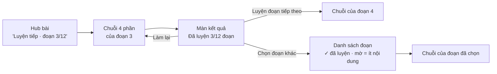

# Luyện bài dài theo đoạn (chuỗi luyện bài tự tạo)

> Trạng thái: **ĐÃ CODE** (duyệt 2026-10-11, dùng các đề xuất K1–K7). Commit: `1da1e1d`, `1f66ad0`, `44c2128` + commit tài liệu. Xem §8 cho điểm lệch. Ngày lập: 2026-10-11.
> Repo: `LingoBites-App` (không đổi server, không migration, không thêm dependency).
> Nối tiếp `2026-10-11-self-created-lesson-practice.md` (quyết định D6, D7). Tổng quan: `docs/architecture/lesson-design.md` §5.

## 1. Vấn đề

Chuỗi luyện 4 phần của bài tự tạo chỉ lấy **một đoạn tối đa 8 câu**: đoạn liền nhau có nhiều từ vựng nhất (`pickStudyWindow`, D6). Đoạn này cố định theo nội dung bài; "Làm lại" chỉ xáo câu hỏi.

Bài dài (transcript YouTube 50–100 câu, văn bản dài) vì vậy chỉ luyện được khoảng 10% nội dung; phần còn lại không bao giờ được luyện.

## 2. Mục tiêu

- Bài trên 8 câu được chia thành **các đoạn** liền nhau.
- "Bắt đầu học" tự mở **đoạn chưa luyện tiếp theo**, không thêm bước chọn.
- Màn kết quả có **"Luyện đoạn tiếp theo"** và **"Chọn đoạn khác"** (danh sách đoạn, đánh dấu đoạn đã luyện).
- Hub và màn kết quả hiện tiến độ "Đã luyện 3/12 đoạn".

Ngoài phạm vi: bài 6 bước, bài giáo trình, cách chấm từng phần, đồng bộ tiến độ đoạn lên server.

## 3. Quyết định (dùng đề xuất nếu bạn không đổi)

| # | Câu hỏi | Đề xuất |
|---|---|---|
| K1 | Chia đoạn thế nào | Chia **đều** theo thứ tự câu, mỗi đoạn tối đa 8 câu: số đoạn = ⌈số câu / 8⌉, câu chia đều (17 câu → 6, 6, 5). Tránh đoạn cuối chỉ 1–2 câu. Bài ≤ 8 câu: một đoạn, giống hệt hiện nay. |
| K2 | Đoạn mở mặc định | Lần đầu: **đoạn 1**, đi lần lượt 1 → 2 → 3. Hết đoạn chưa luyện thì quay lại đoạn luyện lâu nhất. (Phương án khác: lần đầu vẫn lấy đoạn nhiều từ nhất như D6; mình không chọn vì người học xem video / đọc bài theo thứ tự.) |
| K3 | Hoàn thành bài | **Giữ D1**: làm xong chuỗi của **một đoạn bất kỳ** là bài hoàn thành (không bắt luyện hết mọi đoạn). Tiến độ đoạn chỉ để hiển thị và chọn đoạn tiếp. |
| K4 | Lưu đoạn đã luyện ở đâu | Bảng `app_settings` có sẵn trên máy, khoá `practice.segments.<lessonId>`, giá trị JSON `{revision, done: {<số đoạn>: <thời điểm>}}`. **Không migration, không sync.** Đổi `content_revision` (bài được sửa) thì tiến độ đoạn bị bỏ. Cài lại app thì mất tiến độ đoạn; bài vẫn ở trạng thái hoàn thành. |
| K5 | Đoạn quá ít nội dung | Đoạn không đủ để dựng chuỗi (dưới 2 phần hoặc quá ít câu hỏi) hiện mờ trong danh sách, kèm "Đoạn này ít nội dung", không chọn được. Bài có chuỗi khi **ít nhất một** đoạn dựng được. |
| K6 | Gợi ý "Học sâu theo 6 bước" (C) | Lấy câu từ **đoạn vừa luyện** (thay cho đoạn nhiều từ nhất), vẫn lọc bằng `composePickIssue()`. |
| K7 | Bài YouTube | Mỗi đoạn trong danh sách hiện khoảng thời gian `mm:ss – mm:ss` (từ `start_ms` / `end_ms`) cùng câu đầu của đoạn. Bài chữ chỉ hiện câu đầu. |

## 4. Luồng người học

## 5. Thay đổi theo file

### Commit 1 – Chia đoạn (logic thuần)
- `src/core/learning/lessonPractice.ts`:
  - thêm `lessonPracticeSegments(snapshot)` → `{index, sentenceIds, startMs?, endMs?}[]` theo K1;
  - `buildLessonPracticePlan(snapshot, seed, {segment})` dựng chuỗi trên đúng đoạn được truyền vào; không truyền thì giữ hành vi cũ;
  - `pickStudyWindow` giữ nguyên cho chỗ khác còn dùng.
- `src/core/learning/index.ts`: export hàm mới.
- Test: `core/learning/__tests__/lessonPractice.test.ts` (chia 8 / 9 / 17 / 100 câu, đoạn ít nội dung, seed chỉ đổi thứ tự câu hỏi).

### Commit 2 – Lưu tiến độ đoạn và chọn đoạn mặc định
- `src/features/practice/logic/practiceSegments.ts` (mới): đọc / ghi `app_settings` (theo mẫu `mediaDownloadConsent.ts`), `nextSegment()` theo K2, bỏ dữ liệu khi lệch revision (K4).
- `src/features/practice/logic/useLessonPracticeRun.ts`: giữ đoạn hiện tại; xong đoạn thì ghi tiến độ; thêm `startSegment(index)`; trả về `segments`, `segmentIndex`, `doneCount`.
- `src/features/lesson/flow/logic/practiceCompletion.ts`: `hasLessonPracticeRun` đúng khi có ít nhất một đoạn dựng được (K5).
- `src/features/lesson/player/logic/composePick.ts`: `suggestComposePick(snapshot, sentenceIds?)` dùng đoạn vừa luyện (K6).
- Test: unit cho `practiceSegments.ts`; mở rộng `PracticeScreen.run.real-sqlite.test.tsx` (đoạn 1 → 2, quay vòng, lệch revision).

### Commit 3 – Giao diện
- `src/features/practice/components/LessonPracticeRunView.tsx`: tiêu đề "Đoạn 3/12"; màn kết quả có tiến độ và hai nút "Luyện đoạn tiếp theo", "Chọn đoạn khác".
- `src/features/practice/components/PracticeSegmentSheet.tsx` (mới): danh sách đoạn (K5, K7).
- `src/features/lesson/player/screens/CanonicalLessonPlayerScreen.tsx`: nhãn nút "Luyện tiếp · đoạn N/M" khi bài có nhiều đoạn.
- i18n `vi` / `en`: chuỗi mới.
- Test: component cho sheet, hub hiện nhãn đúng.

### Commit 4 – Tài liệu
- `docs/architecture/lesson-design.md` §5: thay mô tả "tối đa 8 câu" bằng chia đoạn.
- Plan này: đánh dấu "ĐÃ CODE" + mục điểm lệch, rồi chuyển vào `archive/plans/`.

## 6. Rủi ro

| # | Rủi ro | Cách giảm |
|---|---|---|
| R1 | Tiến độ đoạn chỉ nằm trên máy (K4), mất khi cài lại hoặc đổi máy | Chấp nhận: chỉ ảnh hưởng gợi ý đoạn tiếp; trạng thái hoàn thành bài vẫn sync như cũ |
| R2 | Nhiều tài khoản trên cùng máy dùng chung `app_settings` | Khoá theo `lessonId`; bài tự tạo thuộc về một người học, nên không trùng |
| R3 | Xoá bài để lại dòng `app_settings` thừa | Dòng nhỏ, vô hại; xoá kèm khi xoá bài nếu chỗ xoá bài gọi được gọn |
| R4 | Gợi ý C đổi từ đoạn nhiều từ nhất sang đoạn vừa luyện | Đúng với ý người học hơn; vẫn sửa được lựa chọn trước khi gửi |

## 7. Kiểm tra trước khi push

`yarn tsc`, `yarn lint`, `yarn format:check`, `yarn test` (các file test liên quan và toàn bộ Jest).

## 8. Kết quả và điểm lệch so với plan

| # | Plan | Thực tế | Lý do |
|---|---|---|---|
| L1 | `practiceSegments.ts` ở `features/practice/logic/` | Ở `features/lesson/flow/logic/practiceSegments.ts`, export qua `@features/lesson` | Hub (`features/lesson`) cũng đọc tiến độ đoạn; `features/practice` đã import `features/lesson`, đặt ngược lại sẽ tạo vòng import và vi phạm luật ranh giới module |
| L2 | `PracticeSegmentSheet.tsx` (bottom sheet) | `PracticeSegmentList.tsx`: danh sách mở ra ngay trên màn kết quả bằng nút "Chọn đoạn khác" | `ui/` chưa có bottom sheet dùng chung; danh sách tại chỗ ít code hơn và dễ test hơn |
| L3 | Test component riêng cho sheet | Danh sách được test qua `PracticeScreen.run.real-sqlite.test.tsx` (mở danh sách, chọn đoạn) | Đủ phủ hành vi; không thêm file test trùng |
| L4 | — | Nhãn hub chỉ đổi thành "Luyện tiếp · đoạn N/M" **sau khi** đã luyện ít nhất một đoạn; lần đầu vẫn là "Bắt đầu luyện" | Tránh nhãn "Luyện tiếp" khi người học chưa luyện gì |
| L5 | — | Lỗi ghi `app_settings` khi xong đoạn được bỏ qua (try/catch) | Tiến độ đoạn chỉ dùng để gợi ý; lượt làm và hoàn thành bài vẫn được ghi |

**Kiểm tra:** `tsc` sạch; `yarn lint` đạt (175/281 warning, file mới không thêm warning); `yarn format:check` đạt; Jest toàn bộ 2469 pass (3 skip). Test mới: `lessonPractice.test.ts` (chia đoạn), `practiceSegments.real-sqlite.test.ts`, 4 ca trong `PracticeScreen.run.real-sqlite.test.tsx`, 1 ca trong `CanonicalLessonPlayerScreen.hub.test.tsx`.

**Chưa kiểm:** chạy trên máy thật (giao diện danh sách đoạn, bài YouTube dài thật).
