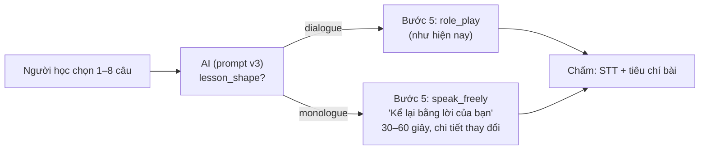

# Bài 6 bước từ nội dung không phải hội thoại (hướng B)

> Trạng thái: **PLAN, chờ duyệt**. Chưa code. Ngày lập: 2026-10-11.
> Repo: `LingoBites-Server` (+ `admin-web`) và `LingoBites-App`.
> Đã làm trước (cùng ngày, không nằm trong plan này): **A** – `COMPOSE_NOT_SUITABLE` không trừ lượt; **D** – prompt `lesson.compose` v2 (độc thoại → tình huống "kể cho người khác nghe", 1 câu là đủ); chọn **1–8 câu**. Runbook: `LingoBites-Server/docs/03-operations/compose-prompt-v2.md`.
> Tổng quan bài học: `docs/architecture/lesson-design.md` §6.

## 1. Vấn đề

Bài "Học sâu theo 6 bước" luôn dựng **bước 5 là nhập vai hai người** (`role_play`, 4–8 lượt, người học phải có lượt khớp đúng khung mẫu câu). Với nội dung độc thoại (vlog, bài giảng, kể chuyện):

- Prompt v2 đã cho AI biến độc thoại thành "bạn bè hỏi – người học kể", nên phần lớn video giờ dựng được bài.
- Nhưng cuộc "hội thoại" đó là **AI bịa thêm**: người kia hỏi những câu không có trong video, người học trả lời theo khung. Với bài giảng hay hướng dẫn, nhiệm vụ tự nhiên nhất lại là **kể lại / tóm tắt / hướng dẫn lại bằng lời của mình**, không phải nhập vai.
- Lượt nhập vai phải khớp khung bằng regex, là nguyên nhân chính của `COMPOSE_AI_INVALID` (AI viết lệch một chút là trượt sau 1 lần sửa).

## 2. Mục tiêu

- Bài 6 bước có **hai dạng**, AI chọn theo nội dung:
  - `dialogue`: như hiện nay, bước 5 nhập vai.
  - `monologue`: bước 5 là **nhiệm vụ nói độc lập** "Kể lại / Giới thiệu / Hướng dẫn lại bằng lời của bạn" (nói khoảng 30–60 giây, có mục đích và chi tiết thay đổi so với video), chấm bằng bộ chấm hiện có (tiêu chí bài, item bắt buộc phải xuất hiện).
- Bước 2–4 giữ nguyên (nghe – nhắc lại đúng đoạn video, thẻ item, luyện mẫu câu).

Ngoài phạm vi: chấm phát âm, chấm nội dung tự do bằng AI (bộ chấm vẫn là STT + so item / từ khoá), nới khung mẫu câu (hướng C, xem §7).

## 3. Quyết định (dùng đề xuất nếu bạn không đổi)

| # | Câu hỏi | Đề xuất |
|---|---|---|
| M1 | Có làm B ngay không | **Chưa.** Kích hoạt prompt v2 trước, theo dõi 1–2 tuần tỷ lệ `NOT_SUITABLE` / `AI_INVALID` của bài YouTube trên trang admin. Chỉ làm B nếu bài độc thoại vẫn hỏng nhiều hoặc phản hồi "hội thoại gượng". |
| M2 | Ai chọn dạng bài | AI, qua trường mới `lesson_shape` trong đầu ra. Có hội thoại thật → `dialogue`; còn lại → `monologue`. |
| M3 | Bước 5 của `monologue` là gì | Hoạt động mới `speak_freely` (gắn task `independent`, `response_mode: speak`, viết thay được như A13), **không** dùng `role_play`. Lý do không tái dùng "tả lại" của Khoảnh khắc: đó là task cộng thêm, không phải block bước 5. |
| M4 | Mẫu câu với `monologue` | Vẫn 1–2 khung có slot (bước 3–4 cần slot để sinh bài tập). Item bắt buộc là cụm từ người học phải dùng khi kể lại. |
| M5 | Tương thích ngược | Đổi `COMPOSE_SCHEMA_VERSION` → `compose-v2`; `role_play` thành `null` được khi `lesson_shape = monologue`. Prompt v1/v2 cũ không chạy được với schema mới, nên ra kèm **prompt v3** (đổi output template). Bài đã dựng trước đó không đổi. |
| M6 | App cũ chưa biết `speak_freely` | Server chỉ dựng `monologue` khi app báo hỗ trợ (`capabilities` có `lessons.compose.shapes` chứa `monologue`); app cũ vẫn nhận bài `dialogue`. |

## 4. Thiết kế



Đầu ra AI (phần đổi):

```jsonc
{
  "lesson_shape": "dialogue" | "monologue",
  "role_play": { ... } | null,          // null khi monologue
  "independent_task": {
    "title_vi": "Kể lại buổi sáng của bạn",
    "prompt_vi": "Kể cho đồng nghiệp nghe sáng cuối tuần của bạn trong khoảng 30 giây: dậy lúc mấy giờ, uống gì, làm gì.",
    "situation": { ... },
    "talking_points_vi": ["giờ dậy", "đồ uống", "việc làm sau đó"]   // mới, 2–4 ý
  }
}
```

## 5. Thay đổi theo file

### Server
- `composer/model/composeOutput.ts`: `lesson_shape`, `role_play` nullable theo shape, `talking_points_vi`; `composeAnswerProblems`: luật nhập vai chỉ áp cho `dialogue`; `monologue` không được có `role_play`.
- `composer/prompts/composeDefaultV3.ts` (mới): template đầu ra mới, hướng dẫn chọn shape, ví dụ vlog dạng `monologue`.
- `composer/service/composeLesson.ts`: shape `monologue` dựng block bước 5 `speak_freely` gắn task `independent`.
- `curriculum/lessonBlocks`: thêm `activityKind` `speak_freely` (schema nội dung: `talkingPointsVi`, `targetSeconds`).
- `curriculum/spec/service/specValidator.ts`: chấp nhận `speak_freely` là hoạt động bước 5 mang task độc lập.
- `capabilities`: `lessons.compose.shapes`.
- Golden cases: thêm bài giảng ngắn, hướng dẫn nấu ăn (kỳ vọng `monologue`).
- ⚠️ **Đổi API public** (nội dung block mới, schema compose). Không migration DB (dữ liệu nằm trong JSON block / task hiện có).

### App
- `core/schemas/activityContent.ts`: nội dung `speak_freely`.
- `features/lesson/flow/components/activities/SpeakFreelyActivity.tsx` (mới): hiện ý cần nói, ghi âm, gửi chấm như bước 5 hiện có (dùng lại `RecorderControls`, `EvaluationFeedback`, nút "Không nói được lúc này").
- `ActivityBody.tsx`: định tuyến kind mới.
- Gửi `capabilities` hỗ trợ `monologue`.
- i18n vi/en.

### Admin-web
- Xem trước bài 6 bước: hiển thị block `speak_freely`.

## 6. Kiểm thử
- Server: unit cho schema / luật chéo theo shape, `composeLesson` dựng đúng bước 5, spec-check; DB test pipeline với AI giả trả `monologue`; app cũ (không báo capability) chỉ nhận `dialogue`.
- App: component `SpeakFreelyActivity`, player chạy bài `monologue` từ fixture, gửi chấm.
- Thử thật: 5 video YouTube độc thoại (vlog, TED ngắn, hướng dẫn nấu ăn, tin tức, kể chuyện) với AI thật trên staging.

## 7. Rủi ro và phương án thay thế

| # | Rủi ro | Cách giảm |
|---|---|---|
| R1 | Bộ chấm hiện tại so item / từ khoá, kể lại tự do dễ bị chấm "chưa đạt" oan | Item bắt buộc chỉ 2–3 cụm then chốt; theo dõi tỷ lệ đạt bài của `monologue` |
| R2 | Ba phiên bản prompt cùng tồn tại | v3 thay v2 khi kích hoạt; rollback về v2 vẫn dựng được bài `dialogue` |
| R3 | `AI_INVALID` vẫn cao vì khung mẫu câu | Hướng **C** (nới khung: chấp nhận lượt gần đúng, cụm cố định không slot) làm riêng nếu số liệu sau v2 cho thấy cần |
