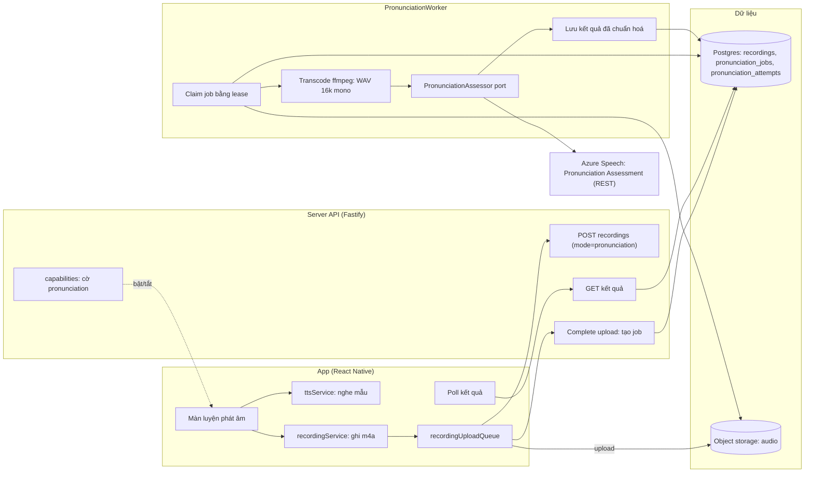
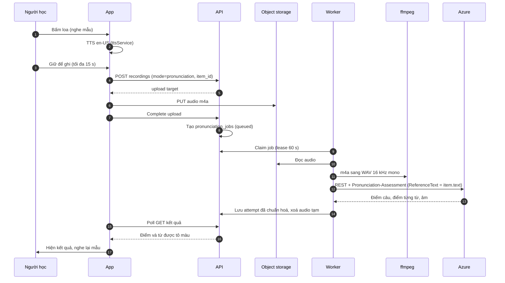
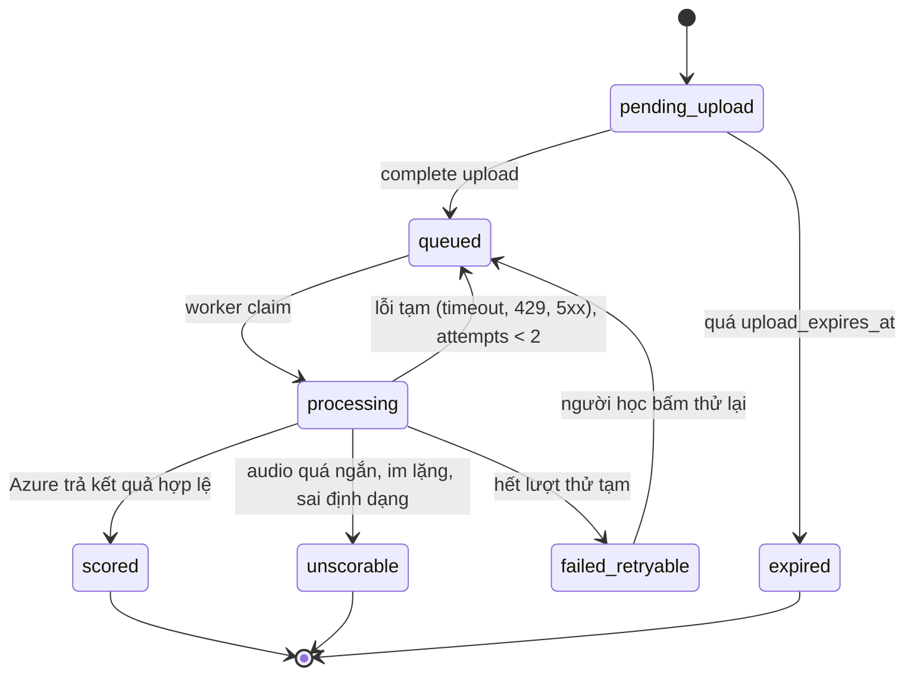
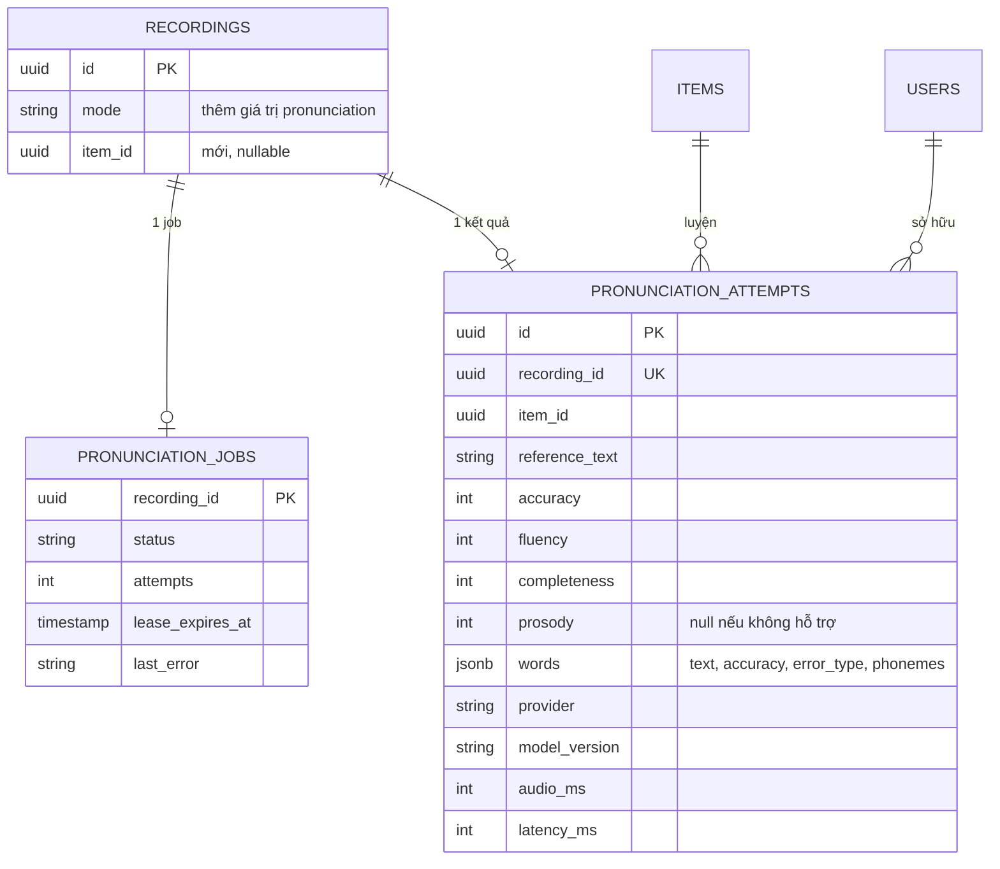

# Kiến trúc phát âm LingoBites

> Trạng thái: **ĐỀ XUẤT**, chưa được duyệt. Ngày: 2026-10-12.
> Repo: `LingoBites-App` và `LingoBites-Server`.
> Đi trước: `2026-10-11-speech-pronunciation-feedback-options.md` (so sánh hai hướng chấm).

Mục tiêu: người học nghe mẫu, ghi âm, nhận điểm theo từng từ và từng âm. Mỗi bước kết thúc ở trạng thái chạy được, không có bản tạm.

## 1. Quyết định chính

| Vấn đề | Đề xuất | Lý do |
|---|---|---|
| Bộ chấm | Azure Pronunciation Assessment (REST short audio) | Đo được phát âm theo từ và theo âm. OpenAI logprobs chỉ báo "máy không chắc", không phải điểm phát âm. |
| Cách tích hợp | Port `PronunciationAssessor` riêng, không tái dùng `evaluateUtterance` | `evaluateUtterance` chỉ so text với câu mẫu. Không đo được âm sai. |
| Định dạng audio | App giữ m4a. Server chuyển sang WAV 16 kHz mono bằng ffmpeg trong worker | Azure không nhận m4a. Không đổi máy ghi của app nên không ảnh hưởng luồng bài nói hiện có. |
| Dependency | Không thêm npm. ffmpeg là dependency hệ thống (cần duyệt) | `fetch` đủ cho REST. `child_process` gọi ffmpeg. |
| Lưu kết quả | Bảng mới `pronunciation_jobs`, `pronunciation_attempts` | Item không phải task, nên không thể đặt vào `evaluations` (cột `task_id` bắt buộc). |
| Bật tính năng | Cờ riêng `PRONUNCIATION_ENABLED`, mặc định `false` | Tách khỏi cờ `SPEECH_EVALUATION_ENABLED` để bật độc lập. |
| Trẻ em | Không gửi đi chấm máy | Đã có quy tắc A11. Kiểm tra ở server, không chỉ ở app. |

## 2. Sơ đồ hệ thống

Worker là tiến trình riêng, dùng cơ chế lease giống `evaluation_jobs`. API không gọi Azure trực tiếp.

## 3. Luồng một lần luyện

## 4. Vòng đời một lần luyện

`unscorable` là kết quả hợp lệ, không phải lỗi. UI hiện lý do cụ thể ("Nói to hơn", "Ghi âm quá ngắn").

## 5. Dữ liệu

Migration: thêm hai bảng và một cột nullable. Không đổi bảng `evaluations`. Kiểm tra ràng buộc check trên `recordings.mode` trước khi thêm giá trị mới. Không lưu bản chữ người học nói, chỉ lưu điểm và text mẫu.

## 6. Việc phải làm theo thành phần

### Server

| File / module | Việc |
|---|---|
| `common/pronunciation/assessor.ts` (mới) | Interface `PronunciationAssessor` và kiểu kết quả đã chuẩn hoá. Không lộ kiểu của Azure. |
| `common/pronunciation/azureAssessor.ts` (mới) | Adapter REST bằng `fetch`. Header `Pronunciation-Assessment` (base64 JSON). Lỗi chỉ mang mã HTTP, không mang body. |
| `common/audio/transcode.ts` (mới) | Gọi ffmpeg qua `child_process.spawn`: m4a sang WAV PCM 16 kHz mono. Có timeout và thư mục tạm riêng. |
| `modules/pronunciation/service/pronunciationWorker.ts` (mới) | Vòng claim và lease giống `evaluationWorker`. Đọc audio, transcode, gọi assessor, lưu, xoá audio tạm. |
| `modules/pronunciation/controller/` (mới) | GET kết quả theo `recording_id`. Chỉ trả về cho chủ sở hữu. |
| `modules/recordings/controller/recordings.ts` | Nhận `mode=pronunciation` và `item_id`. Khi complete upload thì tạo `pronunciation_jobs`. |
| `app/controller/capabilities.ts` | Thêm cờ `pronunciation` riêng, không dùng chung cờ `speech`. |
| `common/config/env.ts`, `.env.example` | `PRONUNCIATION_ENABLED` (mặc định false), `AZURE_SPEECH_KEY`, `AZURE_SPEECH_REGION`, `PRONUNCIATION_DAILY_LIMIT`. Secret không ghi giá trị thật. |
| Migration (mới) | Hai bảng mới, một cột nullable, một giá trị mới cho `mode`. |
| `Dockerfile` / deploy | Cài ffmpeg. Health check báo lỗi nếu không tìm thấy ffmpeg khi cờ bật. |

### App

| File / module | Việc |
|---|---|
| `features/pronunciation/` (mới) | Tính năng tách khỏi `speaking` và `lesson/player`: màn luyện, hook trạng thái, mapper kết quả. |
| Màn luyện | Nghe mẫu, ghi, upload, poll, hiện kết quả. Có nút thử lại và nghe lại mẫu. |
| Hiển thị kết quả | Tô màu từng từ theo ngưỡng. Từ sai thì mở các âm sai. Điểm câu hiện ở đầu. |
| `recordingService.ts` | Giữ m4a. Thêm giới hạn 15 s cho mode này. Không đổi cấu hình ghi âm. |
| `LessonPronunciationSection.tsx` | Thêm nút "Luyện phát âm" cho từng item, mở màn luyện. |
| `core/release/feature-registry.ts` | `pronunciationSupport` chuyển sang `ready` khi đã có đủ đầu cuối và được bật. |

### Phần nghe mẫu (đã làm, xem mục 7)

## 7. Trạng thái phần nghe mẫu (đã làm)

- `ttsService.speak` dừng tiếng đang đọc trước khi đọc mới, nên các lần bấm không chồng tiếng.
- Kết quả của `speak` không còn chuỗi tiếng Việt cứng trong `ttsService`. Chỉ trả về mã lỗi, UI dịch theo i18n.
- Hook `useSpeak` (`features/audio/logic/useSpeak.ts`):
  - báo lỗi tại chỗ trên màn bài học (`lesson-speech-notice`), thay vì nuốt lỗi như trước;
  - dừng tiếng khi màn đóng hoặc app xuống nền.
- Bài "Nghe và chọn" trong mục Phát âm: app đọc một từ của cặp, người học chọn từ đúng. Chấm đúng sai tuyệt đối, không cần chấm giọng. Logic nằm ở `minimalPairQuiz.ts`, có test.

**Đính chính:** tài liệu trước ghi "gỡ TtsSpike khỏi navigation của người dùng". Kiểm tra lại thì lối vào màn này nằm trong `__DEV__` ở `SupportAboutScreen.tsx`, nên người dùng production không thấy. Không cần gỡ.

**Chưa làm:** cache kiểm tra giọng en-US. Lần bấm nào cũng kiểm tra lại. Cache cần thiết kế lại cùng test, vì test hiện dùng mock chung.

**Chưa sửa các lời gọi `speak` khác** (ôn tập, gợi ý, bài tập nói). Các chỗ này vẫn nuốt lỗi bằng `.catch(() => undefined)`. Nên đưa vào `useSpeak` ở đợt sau.

## 8. Quy tắc cố định

- **Trẻ em:** không gửi đi chấm máy (A11). Kiểm tra ở server.
- **Cờ:** `PRONUNCIATION_ENABLED=false` mặc định. Tắt cờ thì endpoint trả 403 và UI ẩn nút.
- **Riêng tư:** không log text người học nói, không log audio, không log nội dung response của Azure. Chỉ log mã lỗi và độ trễ.
- **Đồng ý:** mở màn ghi âm chỉ sau khi người học đồng ý gửi giọng sang Microsoft Azure. Cập nhật thông báo riêng tư nêu rõ bên xử lý này.
- **Giữ audio:** xoá audio tạm sau khi chấm, hoặc theo chính sách retention hiện có. Cần chốt.
- **Chi phí:** giới hạn số lần chấm mỗi người mỗi ngày. Lưu `audio_ms` để tính chi phí thật trong trang admin.

## 9. Lộ trình

| Bước | Nội dung | Điều kiện hoàn thành |
|---|---|---|
| 0 | Thử 50–100 clip trên Azure. Đo độ chính xác và chi phí thật. Không sửa code tính năng. | Bắt đúng đa số từ sai. Báo nhầm chấp nhận được. Có chi phí thật trên hóa đơn thử. Xác nhận endpoint và giới hạn độ dài. |
| 1 | Hoàn thiện nghe mẫu và bài "Nghe và chọn" | **Đã làm.** Test pass, lint sạch, `tsc` sạch. |
| 2 | Server: assessor, transcode, worker, API, migration, cờ | Test adapter với fetch giả, transcode với m4a mẫu, worker với assessor giả và lỗi tạm, endpoint người dùng khác trả 404. |
| 3 | App: màn luyện và hiển thị kết quả | Mapper với fixture đã chuẩn hoá. Màn với các trạng thái queued, scored, unscorable, failed. |
| 4 | Bật dần và đo | Bật cho tài khoản nội bộ, rồi nhóm nhỏ. Theo dõi tỉ lệ scored, độ trễ, chi phí mỗi lần, và phản hồi không đồng ý với kết quả. Ngưỡng màu chỉnh theo dữ liệu. |

## 10. Rủi ro và điều chưa xác minh

| Điểm | Trạng thái | Hướng xử lý |
|---|---|---|
| Giới hạn 30 s cho REST | Chưa xác nhận từ tài liệu chính thức | Thiết kế dùng tối đa 15 s nên không phụ thuộc. Kiểm tra ở bước 0. |
| Giá Azure | Nguồn mâu thuẫn: $0,30/giờ (add-on) hay $1/giờ (real-time). Trang giá Trung Quốc khác. | Không dựa vào con số nào. Đo trên hóa đơn thử ở bước 0. |
| Endpoint hỗ trợ chấm | Một nguồn cộng đồng nói fast transcription không hỗ trợ | Gọi đúng endpoint short-audio kèm header. Xác nhận bằng lần gọi thật ở bước 0. |
| ffmpeg | Dependency hệ thống mới | Cần duyệt. Cài trong image Docker. Health check. |
| Mở rộng sang shadowing, mẫu câu | Quyết định sản phẩm | Port và bảng đủ tổng quát, nhưng đợt này chỉ làm item phát âm. |

## 11. Cần quyết định trước bước 2

1. Engine: đồng ý dùng Azure Pronunciation Assessment, hay chỉ cần "máy không nghe rõ" (khi đó dùng logprobs và ghi rõ trên UI là không phải điểm phát âm)?
2. Chấp nhận gửi giọng người học tới Microsoft Azure và cập nhật consent, thông báo riêng tư?
3. Duyệt cài ffmpeg trong image Docker?
4. Giữ audio: xoá ngay sau khi chấm, hay theo chính sách bản ghi âm hiện tại?
5. Ngân sách: số lần chấm tối đa mỗi người mỗi ngày, và trần chi phí mỗi tháng?
